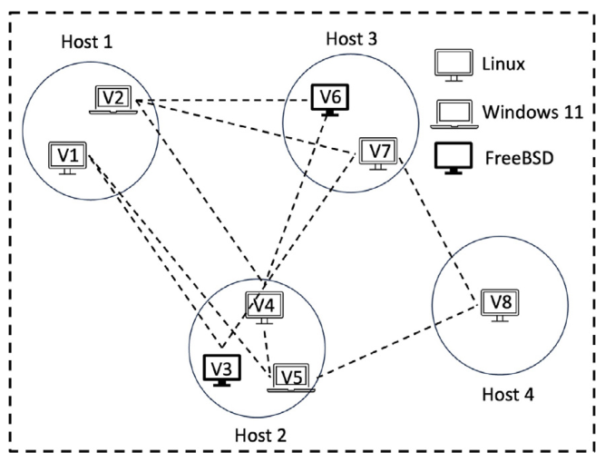
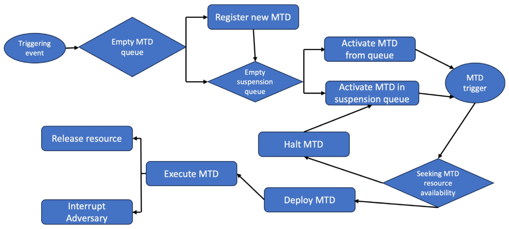
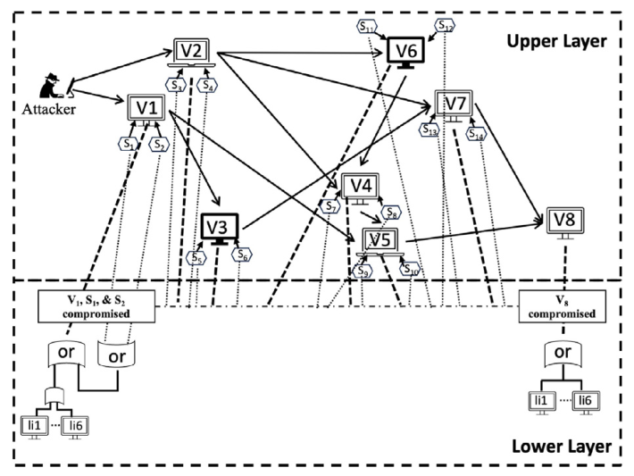
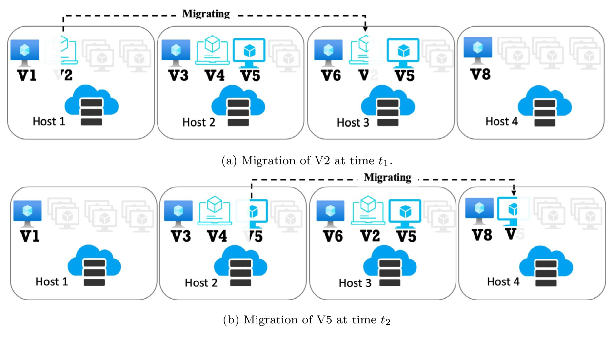
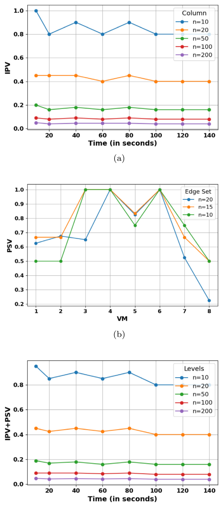
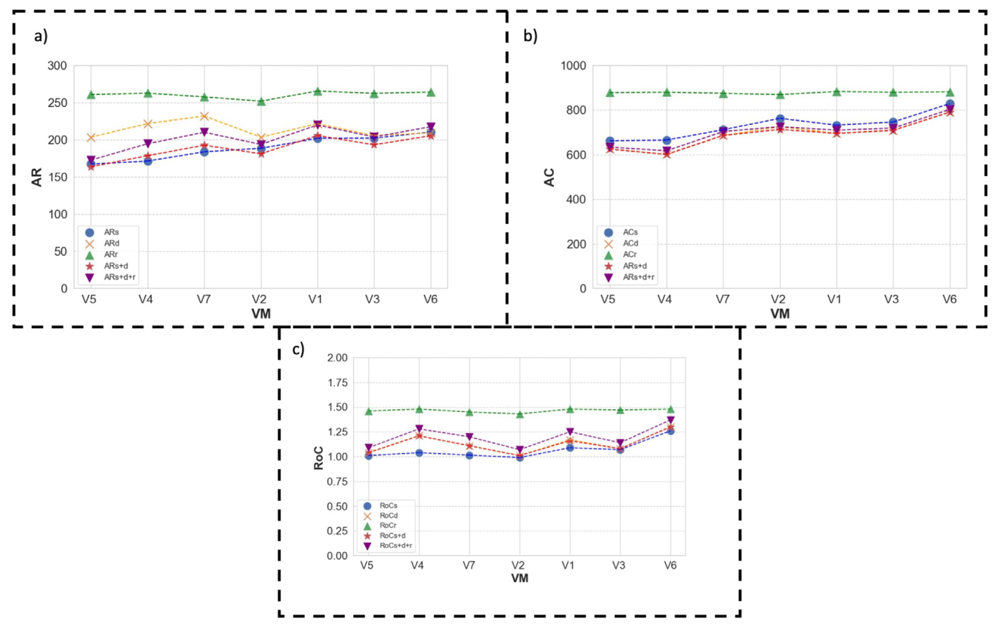
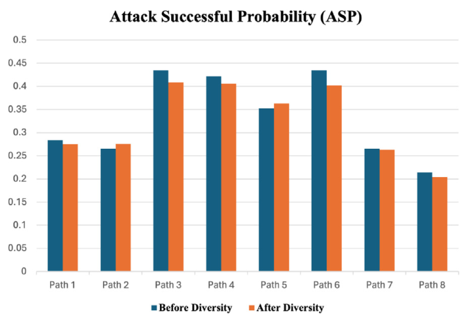
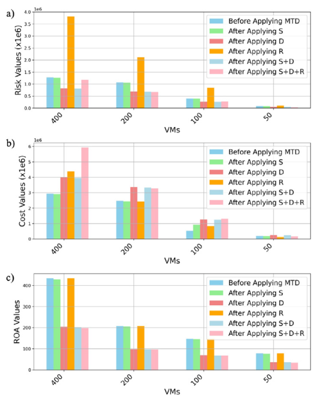
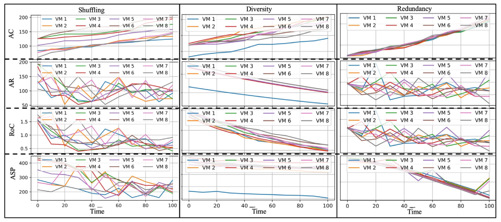

# BẢN DỊCH TIẾNG VIỆT BÀI BÁO CHÍNH – ĐỀ TÀI DT043

| Mục | Nội dung |
|---|---|
| Người thực hiện | Hoàng Thanh Trà |
| MSSV | 1150080120 |
| Lớp | 11_ĐHCNPM_2 |
| Ngày thực hiện | 11/10/2026 |
| Bài báo gốc | Masud M.T., Keshk M., Moustafa N., Turnbull B., Susilo W. *Vulnerability defence using hybrid moving target defence in Internet of Things systems.* Computers & Security 153 (2025) 104380. DOI 10.1016/j.cose.2025.104380 |
| Giấy phép | Bài gốc Open Access theo giấy phép CC BY 4.0, cho phép dịch và phân phối lại khi ghi nguồn. Bản dịch chỉ phục vụ học tập |
| File gốc | `tailieu/docs/báo/Vulnerability defence using hybrid moving target defence in Internet of.pdf` (17 trang) |

Tài liệu gồm hai phần. **Phần I** tóm tắt và phân tích bài báo. **Phần II** là bản dịch toàn văn, giữ đúng thứ tự mục, bảng, thuật toán và hình của bản gốc. Hình được cắt nguyên từ PDF gốc nên chữ trong hình vẫn là tiếng Anh. Những chỗ bản gốc in sai hoặc mâu thuẫn được giữ nguyên nội dung và đánh dấu bằng *[Ghi chú người dịch: …]*. Danh mục tài liệu tham khảo giữ nguyên tiếng Anh.

# PHẦN I. TÓM TẮT VÀ PHÂN TÍCH BÀI BÁO

## 1. Bài báo nói gì (tóm tắt ngắn)

Thiết bị IoT thường có cấu hình tĩnh và ít tài nguyên, nên kẻ tấn công có thời gian dò quét và khai thác lỗ hổng. **Moving Target Defence (MTD)** là hướng phòng thủ chủ động: hệ thống liên tục thay đổi bề mặt tấn công để thông tin kẻ tấn công thu thập được nhanh chóng mất giá trị. Có ba nhóm kỹ thuật MTD: **Shuffle** (xáo trộn: di trú máy ảo, đổi địa chỉ IP), **Diversity** (đa dạng: đổi hệ điều hành) và **Redundancy** (dư thừa: nhân bản máy ảo).

Theo các tác giả, chưa có nhiều nghiên cứu đánh giá hiệu quả khi **kết hợp** các nhóm này trong IoT có xét yếu tố thời gian và chi phí. Bài báo đề xuất phương pháp *Vulnerability Defence* dựa trên mô hình **3-layer THARM** (Temporal Hierarchical Attack Representation Model – mô hình biểu diễn tấn công phân cấp theo thời gian, 3 lớp):

- **Lớp trên U:** đồ thị tấn công giữa các máy ảo (VM).
- **Lớp dịch vụ S:** đồ thị tấn công giữa các dịch vụ IoT chạy trên VM.
- **Lớp dưới L:** cây tấn công (cổng OR) chứa các lỗ hổng CVE của hệ điều hành và dịch vụ trên từng VM.

Kịch bản thử nghiệm là một mạng mô phỏng gồm **4 host vật lý, 8 VM** (Linux, Windows 11, FreeBSD), mỗi VM chạy 2 dịch vụ (14 dịch vụ s1–s14). V8 là VM duy nhất nối tới cơ sở dữ liệu nên là mục tiêu của kẻ tấn công. Dữ liệu lỗ hổng gồm **18 CVE hệ điều hành** (Bảng 1) và **14 CVE dịch vụ** (Bảng 2), lấy điểm CVSS từ NVD. MTD được kích hoạt **theo chu kỳ thời gian** (10 phút). IP shuffling thực hiện qua bộ điều khiển SDN, thay IP thật (rIP) bằng IP ảo (vIP).

Các chỉ số an ninh dùng để đánh giá gồm: xác suất tấn công thành công (ASP), rủi ro tấn công (AR), chi phí tấn công (AC), lợi tức tấn công (RoC = R/AC), các độ đo trung tâm (closeness, degree, betweenness) để chọn VM cần áp MTD, cùng hai độ đo biến thiên IPV (biến thiên IP) và PSV (biến thiên đường tấn công).

**Kết quả chính** (áp MTD lên V5 làm ví dụ):

| Kỹ thuật | Rủi ro R | Chi phí tấn công AC | RoC |
|---|---|---|---|
| Shuffle (V5 di trú host 2 → host 4) | 167.38 | 666.2 | 1.01 |
| Diversity (V5 đổi Windows 11 → Linux) | 163.73 | 624.73 | 1.04 |
| Redundancy (nhân bản V5) | 260.84 | 878.3 | 1.46 |

**Kết luận của bài:** kết hợp MTD **khác nhóm**, đặc biệt **Shuffle + Diversity**, cho kết quả tốt nhất: ASP thấp hơn, rủi ro thấp hơn, chi phí tấn công cao hơn. Redundancy làm tăng độ sẵn sàng của dịch vụ nhưng thêm lỗ hổng. Bộ ba S+D+R giảm AR và RoC so với chỉ dùng R, đồng thời tăng độ tin cậy của mạng.

## 2. Phân tích

**Đóng góp:**

1. Đưa ra khung đánh giá MTD trên mô hình đồ thị 3 lớp có tính đến **dịch vụ** trên VM, không chỉ VM như các bài trước (Bảng 5).
2. Đặt ba nhóm MTD vào đúng lớp của mô hình: shuffle và redundancy làm thay đổi lớp mạng, diversity làm thay đổi lớp lỗ hổng. Bài cũng nêu quy tắc chạy đồng thời: shuffle và redundancy không chạy cùng lúc, diversity chạy song song được.
3. Dùng cùng một bộ chỉ số (ASP, AR, AC, RoC, độ trung tâm) để so sánh các kỹ thuật đơn lẻ và các tổ hợp.

**Hạn chế (nhận xét khi đọc toàn văn):**

1. **Chỉ là mô phỏng trên mô hình đồ thị.** Bài không triển khai IoT thật, không đo QoS. Tác giả tự thừa nhận điều này ở Mục 5, và mục "Data availability" ghi "No data was used".
2. **Công thức in không nhất quán.** Eq. 1 dạng 1 − (∏ + ∏) có thể cho ra số âm. Eq. 2 và Eq. 3 ghi ∏ (tích), nhưng các con số trong bài chỉ khớp khi tính bằng tổng Σ.
3. **Thiếu thông tin để tái lập.** Không có mã nguồn. Bảng 4 và chi phí tấn công theo VM ở Mục 4.2 (37.5; 43.2; 46.4; 39.4) không suy ra được từ Bảng 1–2. Danh sách cạnh sau shuffle bị cắt bằng "…". Hình 5, 8, 9 không nêu cách sinh mạng 10–400 VM.
4. **Mâu thuẫn nội bộ.** Definition 2 thiếu cạnh V6 → V4 có trong Hình 3. Lời bình Hình 7 nói Path 5 giảm ASP nhưng cột trên hình lại tăng. Mục 4.4 ghi nhầm "Diversity" thành tên của H_r. Mục 4 và 4.1 có nhiều câu diễn đạt lạc nghĩa, ví dụ IPV được gọi là "Internet Protocol Version" và "Ingress Protection Value".
5. **Chỉ xét MTD theo thời gian.** Bài nhắc tới hybrid MTD (thời gian + sự kiện) nhưng phần thực nghiệm không có bộ phát hiện xâm nhập nào kích hoạt MTD.

**Liên hệ với đề tài DT043:** bài báo **không** dùng autoencoder, N-BaIoT, lượng tử hóa hay đo trên thiết bị edge. Vì vậy đề tài chia làm hai hướng: tái lập có chọn lọc phần đánh giá MTD (THARM) của bài này, và dùng autoencoder theo Meidan et al. (2018) làm bộ phát hiện để kích hoạt MTD lai. Kết quả kiểm tra phần tái lập nằm trong `tailieu/docs/kiem_tra_tai_lap.md`.

# PHẦN II. BẢN DỊCH TOÀN VĂN

## Phòng thủ lỗ hổng bằng phòng thủ mục tiêu di động lai trong hệ thống Internet vạn vật

**Tác giả:** Mohammed Tanvir Masud (a, tác giả liên hệ), Marwa Keshk (a), Nour Moustafa (a, tác giả liên hệ), Benjamin Turnbull (a), Willy Susilo (b).

(a) University of New South Wales, Canberra, Úc. (b) University of Wollongong, Úc.

Email: mohammed_tanvir.masud@unsw.edu.au (M.T. Masud), nour.moustafa@unsw.edu.au (N. Moustafa).

Computers & Security 153 (2025) 104380 – Bài nghiên cứu đầy đủ. Nhận bài 25/8/2024; nhận bản sửa 10/01/2025; chấp nhận 10/02/2025; đăng trực tuyến 25/02/2025. © 2025 Các tác giả. Xuất bản bởi Elsevier Ltd. Bài báo truy cập mở theo giấy phép CC BY.

**Từ khóa:** Phòng thủ mục tiêu di động (MTD); An ninh IoT; Tác nhân đe dọa mạng; Tài sản kết nối mạng; Chỉ số an ninh; Động học bề mặt tấn công; Đánh giá rủi ro; Khả năng chống chịu mạng; Hiệu quả an ninh mạng; Phân tích an ninh.

### Tóm tắt

Các tác nhân đe dọa mạng ngày càng nhắm vào tài sản kết nối mạng và hạ tầng trọng yếu, có thể gây tác động lớn về kinh tế – xã hội. Phòng thủ mục tiêu di động (MTD) là một mô hình phòng thủ mạng tạo ra bề mặt tấn công (tức các lỗ hổng) liên tục thay đổi. MTD nhằm khiến đối thủ khó khai thác hệ thống hơn, qua đó làm tăng chi phí và khả năng bị phát hiện của họ. Hiện còn thiếu nghiên cứu về hiệu quả của các kỹ thuật MTD khi kết hợp, đặc biệt khi xét nhiều khía cạnh an ninh như thời gian, chi phí và công sức. Khoảng trống này đặc biệt đáng kể trong bối cảnh Internet vạn vật (IoT), nơi các vấn đề an ninh nảy sinh từ kiến trúc không đồng nhất. Hơn nữa, MTD có thể dẫn tới việc sử dụng quá mức tài nguyên mạng và hệ thống để tăng cường an ninh. Chúng tôi trình bày một phương pháp Phòng thủ lỗ hổng (Vulnerability Defence) để giải quyết vấn đề này, sử dụng Mô hình biểu diễn tấn công phân cấp theo thời gian ba lớp (3-layer-THARM). Cách tiếp cận này khắc phục khó khăn bằng cách đánh giá mức an toàn của các trạng thái mạng tổng hợp, xét các chỉ số an ninh ở từng trạng thái và khả năng truy cập của các nút và cạnh mạng. Với mô hình này, chúng tôi có thể nhận diện các kịch bản tấn công có thể xảy ra trong hệ thống IoT, phân tích an ninh hệ thống IoT một cách toàn diện bằng các chỉ số an ninh được định nghĩa rõ ràng, và đánh giá hiệu quả của các chiến thuật phòng thủ khác nhau. Đặc tính này tự thân bổ sung thêm một tầng an ninh cho hệ thống. Ngoài ra, mô hình còn thể hiện khả năng xác định các đường tấn công tiềm năng và giảm thiểu hiệu quả hậu quả của các cuộc tấn công đó. Phân tích của chúng tôi cho thấy một xu hướng đáng chú ý: kết hợp các kỹ thuật MTD thuộc các nhóm khác nhau, chẳng hạn shuffle và diversity, nhìn chung cho kết quả tốt hơn, bao gồm xác suất tấn công thành công thấp hơn, rủi ro tấn công thấp hơn và chi phí tấn công cao hơn.

### 1. Giới thiệu

Rủi ro an ninh mạng có thể xuất phát từ nhiều điểm yếu và lỗ hổng bảo mật trong hệ điều hành (OS), phần mềm, phần cứng hoặc ứng dụng mạng. Các mối đe dọa mạng phát triển nhanh và tinh vi hơn nhiều, cho phép chúng né tránh hoặc vô hiệu hóa các cơ chế phòng thủ tiêu chuẩn như tường lửa và hệ thống phát hiện xâm nhập (IDS). Mạng IoT thiết kế không tốt sẽ dễ bị các tấn công như thực thi lệnh tùy ý và lập trình lại firmware. Những điểm yếu có thể khai thác như vậy gây rủi ro mang tính hệ thống cho các mạng và cho khả năng chống chịu của Internet. Mã độc Mirai (Kolias et al., 2017) là ví dụ cho thấy mức độ nghiêm trọng của nguy cơ từ thiết bị IoT bị chiếm quyền. Các thiết bị nhiễm Mirai đã phát động một cuộc tấn công DDoS phối hợp vào Dyn, một dịch vụ DNS lớn tại Hoa Kỳ, gây tổn hại doanh thu và uy tín của khách hàng của Dyn. Dyn mất ngay khoảng 8% khách hàng (Neshenko et al., 2019).

Phần lớn nghiên cứu đánh giá lỗ hổng gần đây tập trung vào bảo vệ môi trường IoT (Sicari et al., 2015; Yu et al., 2013). Vì các thành phần này phát triển riêng rẽ, các phương pháp trước đây thường đánh giá an ninh một cách tách biệt, bộc lộ thiếu sót về tính mở và tính chuẩn hóa (Kim and Na, 2016). Các hệ thống hiện nay thu thập dữ liệu từ thế giới thực qua hệ thống IoT, xử lý dữ liệu bằng các dịch vụ IoT khác nhau, rồi kích hoạt hành động trong thế giới vật lý. Do đó, đánh giá toàn diện về truyền dữ liệu an toàn phải bao gồm cả đặc điểm IoT lẫn an ninh mạng. Do hạn chế của thiết kế mạng truyền thống vốn dựa trên mạng đóng, việc mở rộng sang nhiều dịch vụ và tương tác với thiết bị hay dịch vụ khác là khó. Vì vậy, cần một cách tiếp cận riêng để kết nối các mạng hoàn chỉnh với nhau (Kim and Na, 2016).

Trong kỷ nguyên IoT hiện nay, con người sống trong một môi trường có vô số thành phần kết nối mạng. Bên cạnh lợi ích của IoT và điện toán đám mây phổ biến, lĩnh vực này phải giải quyết nhiều vấn đề an ninh. SmartThings (Liaskos et al., 2016) là ví dụ về một khung tấn công độc hại nhắm vào toàn bộ phạm vi giao thoa giữa không gian mạng và thế giới vật lý. Khung tấn công này đã được dùng để đánh cắp mã khóa cửa và tấn công máy tính thông thường. An ninh điện toán đám mây đã trở thành mối quan tâm lớn của các nhà cung cấp đám mây. Thách thức này bắt nguồn từ độ tin cậy về an ninh trong mô hình đang mở rộng này, nhất là khi các tổ chức đám mây cung cấp dịch vụ toàn diện cho khách hàng. Vì vậy, nhiều nghiên cứu đã xem xét kết hợp cả biện pháp an ninh phản ứng lẫn chủ động để tăng cường an ninh cho tài nguyên và dịch vụ điện toán đám mây (Lv et al., 2023; Hu et al., 2018). Cần đánh giá tư thế an ninh của đám mây thay đổi thế nào khi kết hợp nhiều phương pháp an ninh.

Bản chất tĩnh và thụ động của thiết bị IoT tạo ra một loạt thách thức an ninh mạng riêng, mở cơ hội cho kẻ tấn công tìm lỗ hổng mới và tấn công vào lúc thuận tiện. Để giảm thiểu các lỗ hổng này, mô hình an ninh mạng MTD đã xuất hiện như một biện pháp đối phó chủ động, nhằm thay đổi bề mặt tấn công một cách động. Khái niệm MTD dựa trên các nghiên cứu trước về khả năng chịu lỗi, tính toán tái cấu hình được và an ninh mạng lấy cảm hứng sinh học. Các kỹ thuật đa dạng hệ thống nổi tiếng để tăng độ tin cậy gồm lập trình n phiên bản (NVP) (Avizienis, 1985), phần mềm tái cấu hình được (Compton and Hauck, 2002) và tái cấu hình mạng (Baran and Wu, 1989). Ứng dụng sớm cho bảo vệ an ninh mạng là đa dạng phần mềm/mạng (Knight et al., 2016). Ý tưởng MTD được chính thức hóa hơn vào năm 2009, khi Văn phòng Điều phối Quốc gia của Chương trình Nghiên cứu và Phát triển Mạng và Công nghệ Thông tin (NITRD) công nhận MTD là hướng tiếp cận hứa hẹn để đạt an ninh nhờ sử dụng tốt hơn nguồn tài nguyên hạn chế (Chong et al., 2009). Quan trọng hơn, MTD đưa thay đổi vào hạ tầng nền, khiến kẻ tấn công không thể xác định vị trí để tấn công, tạo áp lực rất lớn lên tài nguyên của họ. Chiến lược này nhằm tăng chi phí cho kẻ tấn công trong khi giảm chi phí cho bên phòng thủ, để tạo ra một thế phòng thủ quyết liệt hơn. Bài báo này nhấn mạnh cụ thể các chiến lược MTD có thể triển khai để tăng cường an ninh trong môi trường điện toán đám mây dựa trên IoT.

Các vấn đề an ninh mạng của thiết bị IoT thường được quy cho đặc tính tĩnh và thụ động của chúng, tạo cơ hội để kẻ tấn công xem xét các lỗ hổng có thể có và cẩn thận tiến hành tấn công theo ý muốn. Phòng thủ mục tiêu di động (MTD) là một hệ thống an ninh mạng chủ động, nhằm khắc phục điểm yếu và tăng cường an ninh bằng cách làm cho bề mặt tấn công trở nên động. Cách tiếp cận này tạo đủ độ khó đoán để gây bối rối cho kẻ tấn công và làm phức tạp các nỗ lực đe dọa an ninh (Sengupta et al., 2020). So với các phương pháp khác, chiến thuật MTD được kỳ vọng giảm chi phí phòng thủ, đồng thời tăng chi phí của kẻ tấn công về công sức, thời gian và tài chính. Để duy trì tính khả thi kinh tế và giảm rủi ro tấn công mạng, các phương pháp MTD phòng thủ được đề xuất bắt buộc phải vừa hiệu quả vừa tiết kiệm. Bài báo này sử dụng khả năng của MTD để tăng cường an ninh trong môi trường điện toán đám mây dựa trên IoT.

An ninh hệ thống sẽ thay đổi khi một kỹ thuật MTD được triển khai cho một mục đích cụ thể, như giảm thiểu lỗ hổng hay tăng khả năng chống chịu. Hầu hết các chiến lược MTD được đề xuất thiếu dữ liệu thuyết phục để chứng minh hiệu quả đã tuyên bố. Do đó, cần đánh giá hiệu quả của kỹ thuật MTD bằng các chỉ số an ninh như Lợi tức tấn công (RoA) và Chi phí tấn công (AC), vốn đánh giá an ninh từ góc nhìn của kẻ tấn công, cũng như Rủi ro (R) và Xác suất tấn công thành công (ASP), có thể xem là các chỉ số có ích từ góc nhìn của nhà cung cấp đám mây. Phân tích an ninh là cần thiết để đánh giá toàn diện các khía cạnh an ninh của một hệ thống. Đánh giá hiệu quả của một cách tiếp cận MTD rất quan trọng, vì nó có thể ảnh hưởng đáng kể tới trạng thái an ninh và khả năng chống chịu tấn công mạng nói chung của hệ thống. Các chỉ số an ninh như Chi phí tấn công và Lợi tức tấn công cho thấy những lợi ích kinh tế và chiến lược quan trọng mà MTD mang lại. Ngoài ra, chỉ số rủi ro và xác suất tấn công thành công có thể dùng để đánh giá hậu quả tiềm tàng đối với độ tin cậy của dịch vụ và sự hài lòng của khách hàng. Vì vậy, cần phân tích an ninh kỹ lưỡng trước khi triển khai các phương pháp MTD trong bất kỳ hệ thống nào.

Dù dùng riêng lẻ hay kết hợp, các cách tiếp cận MTD đều mở ra hướng khả thi để cải thiện an ninh và hiệu năng hệ thống. Tuy nhiên, khi kỹ thuật MTD ngày càng nhiều, việc đánh giá hiệu quả khi kết hợp đã trở nên khó khăn (Alavizadeh et al., 2020). Ví dụ, redundancy cải thiện tính sẵn sàng của dịch vụ, còn shuffle cải thiện an ninh đáng kể. Dù vậy, cần thấy rằng triển khai redundancy tùy tiện có thể gây tốn kém về kinh tế và mở rộng bề mặt tấn công. Vì vậy, phải đánh giá cẩn thận các tổ hợp MTD để đạt cân bằng tinh tế giữa an ninh và chi phí. Việc triển khai MTD trong hệ thống điện toán đám mây dựa trên IoT phụ thuộc vào các giới hạn do nhà cung cấp đám mây đặt ra. Ví dụ, áp dụng các cách như đa dạng hệ điều hành hoặc nhân bản máy ảo (VM) (một chiến lược redundancy) đòi hỏi tạo thêm các phiên bản VM, kéo theo chi phí cho nhà cung cấp. Các phương pháp MTD shuffle và redundancy có thể được cài đặt trên nền tảng đám mây với ảnh hưởng tối thiểu tới hiệu năng do gián đoạn hệ thống (Alavizadeh et al., 2018).

**Động lực nghiên cứu.** Các kỹ thuật MTD, dùng riêng hay kết hợp, có thể tăng an ninh và giảm thiểu gián đoạn hệ thống. Kết hợp các phương pháp như redundancy để tăng tính sẵn sàng dịch vụ và shuffle để tăng an ninh mang lại lợi thế riêng. Tuy nhiên, cần triển khai cẩn thận để tránh chi phí kinh tế và mở rộng bề mặt tấn công, đặc biệt với Redundancy. Kết hợp có chiến lược các kỹ thuật MTD nhằm tăng cường an ninh và độ tin cậy, dù sự cộng hưởng không phải lúc nào cũng đảm bảo cải thiện an ninh hệ thống do có thể xảy ra xung đột vận hành. Các nghiên cứu trước đã đề xuất dùng kỹ thuật mô hình hóa giải tích để đánh giá tác động hiệu năng khi kết hợp các phương pháp MTD, nhưng chưa giải quyết thách thức xung đột tiềm tàng khi triển khai nhiều cách tiếp cận MTD khác nhau (Hong and Kim, 2015; Ge et al., 2017a; Ergenc et al., 2020). Vì vậy, cần có một phương pháp kích hoạt theo thời gian để đánh giá tài nguyên sẵn có cho việc triển khai chiến lược MTD. MTD được phát triển như một kỹ thuật phòng thủ chủ động để chống tấn công mạng bằng cách thay đổi động bề mặt tấn công của hệ thống (Maughan, 2009). Cách tiếp cận thiết kế cơ bản định hướng việc phát triển phương pháp MTD xoay quanh ba vấn đề quan trọng (Cai et al., 2016): (1) di chuyển cái gì, (2) di chuyển thế nào và (3) khi nào di chuyển. Trong khi nghiên cứu hiện có tập trung vào xác định di chuyển cái gì và di chuyển thế nào, thành phần thời gian (khi nào di chuyển) cũng được xem là quan trọng (Alavizadeh et al., 2020; Ge et al., 2018). Khía cạnh này đòi hỏi xác định thời điểm tốt nhất để chuyển hệ thống MTD từ trạng thái hiện tại sang trạng thái mới, qua đó vô hiệu hóa mọi thông tin hay tiến triển mà kẻ tấn công thu được ở trạng thái hiện tại. Các cách tiếp cận MTD cần thích nghi chủ động, thực hiện bằng cách thay đổi định kỳ các thiết lập hay thuộc tính sau những khoảng thời gian định trước hoặc ngẫu nhiên.

Ngoài ra, độ phức tạp và sự đa dạng của các hệ thống hiện đại gây khó khăn cho việc giám sát, phân tích và phản ứng với tấn công tiềm tàng theo thời gian thực. Điều chỉnh cơ chế phát hiện mối đe dọa để nhận diện tấn công nhắm vào một mục tiêu động là khó, vì các phương pháp phát hiện thông thường thường được thiết kế cho môi trường tĩnh hoặc tương đối ổn định, nơi bề mặt tấn công được hiểu rõ và ít thay đổi (Carter et al., 2014; Aydeger et al., 2019). Các nghiên cứu hiện nay đang tập trung phát triển thuật toán và công cụ tinh vi có thể giám sát hiệu quả của cơ chế phòng thủ trong hệ thống động.

Dù các kỹ thuật MTD hiện có đã xử lý tốt việc giảm thiểu tấn công trong môi trường tĩnh, chúng vẫn cần đáp ứng yêu cầu của mạng IoT và giới hạn tài nguyên của thiết bị. Các công trình trước chỉ áp dụng shuffle, diversity hoặc redundancy riêng rẽ hoặc kết hợp để tăng an ninh, nhưng chưa kỹ thuật nào có thể thích nghi theo thời gian để đáp lại một cuộc tấn công thời gian thực vào một vùng cụ thể như hệ thống IoT cần. Hơn nữa, các mô hình MTD thông thường thiếu cơ chế định thời để chọn thời điểm phù hợp triển khai chiến lược sao cho vừa giảm chi phí (về tài nguyên phòng thủ) vừa tăng hiệu quả (về mức an ninh tạo ra) của các phương pháp phòng thủ được dùng.

Hạn chế của các công trình trước thúc đẩy chúng tôi thiết kế và xây dựng một mô hình MTD lai gồm shuffle, diversity và redundancy để bảo vệ mạng IoT. Ba chiến lược này xử lý các khía cạnh an ninh khác nhau của IoT: shuffle thêm tính bất định bằng cách tái cấu hình mạng một cách động, diversity tăng độ vững chắc nhờ các thành phần hệ thống đa dạng, còn redundancy đảm bảo dịch vụ liên tục ngay cả khi một số nút bị tấn công. Các chiến lược này phối hợp tạo thành một hệ thống phòng thủ nhiều lớp có tính cộng hưởng, vô hiệu hóa các mối đe dọa IoT từ bên ngoài và bên trong (tức lỗ hổng tĩnh và tài nguyên thiết bị hạn chế).

Mô hình này cho phép dùng các kỹ thuật MTD trong những khoảng thời gian xác định, bằng cách áp dụng thích nghi trong khi điều chỉnh khoảng thời gian lưu trú (residency time-interval), một cách rất tiết kiệm năng lượng cho môi trường IoT hạn chế tài nguyên. Ý tưởng cộng hưởng của cách tiếp cận này là cung cấp một giải pháp cân bằng, mang tính phòng ngừa, để giảm mức thiệt hại do IoT gây ra (đánh giá bằng các chỉ số về khả năng và chi phí tấn công), đồng thời chống chịu được tấn công theo chiều ngang, tức các mối đe dọa vốn phải xử lý riêng lẻ, và theo chiều dọc, tức các giới hạn về khả năng tồn tại của IoT. Cách tiếp cận lai này mang lại một hệ thống phòng thủ cân bằng, có tính đến tài nguyên, không chỉ chống lại các mối đe dọa IoT thời gian thực mà còn đảm bảo độ tin cậy và an ninh dài hạn của hệ thống.

**Mục tiêu nghiên cứu.** Công trình này nhằm thiết kế một mô hình Phòng thủ mục tiêu di động (MTD) lai, kết hợp ưu điểm của các chiến lược shuffle, diversity và redundancy, đồng thời xét tới nhược điểm của các MTD hiện có cho mạng IoT. Mô hình gồm một cách tiếp cận mới dựa trên thời gian, có mô hình điều khiển khoảng thời gian cơ sở, để áp dụng động các kỹ thuật MTD đó trong điều kiện tài nguyên hạn chế và đồng thời một cách tối ưu trước các lỗ hổng đặc thù của IoT khi bị tấn công thời gian thực.

*[Ghi chú người dịch: câu gốc "to tackle MTD land in a limited resource" diễn đạt không rõ; bản dịch giữ ý chính là áp dụng MTD trong điều kiện tài nguyên hạn chế.]*

Nghiên cứu này hướng tới các mục tiêu cụ thể sau:

- Phát triển một phương pháp MTD lai mới, tích hợp shuffle, diversity và redundancy để đáp ứng yêu cầu an ninh riêng của mạng IoT, chẳng hạn cấu hình tĩnh. Mục tiêu này bao gồm cả việc đánh giá các chiến lược kết hợp MTD và phương án thực thi khác nhau trên các kịch bản đặc thù IoT.
- Đề xuất và triển khai một cơ chế điều khiển khoảng thời gian, điều tiết động việc triển khai các chiến lược MTD, gồm đặt VM để shuffle, đa dạng hệ điều hành và redundancy, nhằm tối ưu sử dụng tài nguyên mà vẫn giữ được an ninh.
- Đánh giá chính xác rủi ro an ninh của hệ thống bằng Mô hình biểu diễn tấn công phân cấp theo thời gian 3 lớp (3-Layer THARM). Mô hình phân tích tốt hành vi kẻ tấn công bằng Đồ thị tấn công Bayes của host, Đồ thị tấn công Bayes của dịch vụ trên host và Cây tấn công dịch vụ.
- Kiểm chứng thực nghiệm trong một môi trường IoT mô phỏng, cho thấy ASP giảm đáng kể, AC tăng và khả năng chống chịu của mạng được cải thiện tổng thể.
- Một mô hình tương tác phòng thủ – đối thủ, đánh giá cách các chiến lược MTD phá vỡ động quy trình của kẻ tấn công, buộc chúng phải quét lại, dùng lại thông tin đăng nhập và các nỗ lực khác, làm tăng chi phí và giảm tỷ lệ tấn công thành công.

Bài báo đóng góp như trên cho việc áp dụng MTD theo nhiều thời điểm trong mạng IoT, nhằm xây dựng một hệ thống phòng thủ thích nghi với chi phí tương đối thấp. Qua đó, nó giúp hệ thống IoT tồn tại và vững vàng khi đang bị tấn công thời gian thực.

Phần còn lại của bài được tổ chức như sau. Mục 2 tổng quan bối cảnh và các nghiên cứu liên quan. Mục 3 mô tả cấu hình mạng, gồm mô hình mối đe dọa, khung phòng thủ lỗ hổng và mô hình đề xuất. Mục 4 trình bày kết quả, Mục 5 bàn về hạn chế và hướng mở rộng. Cuối cùng, Mục 6 đưa ra kết luận.

### 2. Tổng quan tài liệu

Mục này tổng quan bối cảnh và các nghiên cứu liên quan tới MTD trong hệ thống IoT.

#### 2.1. Phòng thủ mục tiêu di động (MTD)

MTD là phương pháp chủ động đánh bại các đối thủ có khả năng thích nghi bằng cách tăng chi phí và độ phức tạp cho kẻ tấn công. Mục tiêu chính là liên tục chuyển qua các cấu hình khác nhau trong một mạng hay hệ thống máy tính, thay đổi phần mềm, giao diện mạng đang mở và thiết lập mạng để tăng mức bất định với kẻ tấn công tiềm năng. Việc này phải được thực hiện mà vẫn duy trì dịch vụ ổn định cho người dùng hợp lệ. Các cách tiếp cận MTD khác nhau tùy cách thực hiện thay đổi cấu hình mạng (Zhuang et al., 2014a). **MTD theo thời gian:** khởi động các thủ tục MTD sau những khoảng thời gian đều đặn. Khoảng MTD, tức khoảng cách thời gian giữa hai hoạt động MTD liên tiếp, có thể cố định hoặc thích nghi theo các tham số cụ thể. **MTD theo sự kiện:** kích hoạt các thao tác MTD để đáp lại các tình huống mạng hoặc hành vi quan sát được cụ thể. **MTD lai:** tích hợp phương pháp hướng sự kiện và hướng thời gian trong một số hệ thống MTD (Xu et al., 2023). Ngoài ra, MTD phân loại kỹ thuật thành ba nhóm là Shuffling (xáo trộn), Diversity (đa dạng) và Redundancy (dư thừa), dựa trên cách chúng vận hành theo động học di chuyển mục tiêu (Cho et al., 2020). Hầu hết các đánh giá kỹ thuật MTD chỉ xét kẻ tấn công bên ngoài mà không tính tới cách tiếp cận MTD nào, chẳng hạn MTD theo sự kiện hay MTD theo thời gian (Alavizadeh et al., 2020; Hong and Kim, 2015; Alavizadeh et al., 2022). Trạng thái và lỗ hổng trong các mạng IP hiện đại liên tục thay đổi, khiến chúng rất động. Vì vậy, chúng tôi xét MTD theo thời gian để đánh giá hiệu quả của các kỹ thuật này.

#### 2.2. Đánh giá lỗ hổng

Đánh giá lỗ hổng là phần không thể thiếu để hiểu khả năng các vùng dễ tổn thương bị khai thác, như phần mềm trên host hoặc giao diện liên lạc giữa các host. Nó đặt nền móng cho phân tích rủi ro toàn diện (Zheng et al., 2022). Phân tích này được làm phong phú thêm bởi phân tích lỗ hổng, vốn kết hợp đánh giá lỗ hổng với đánh giá hậu quả vật lý. Đánh giá rủi ro dùng hai cách: phương pháp vượt ngưỡng, dựa trên tiêu chí định trước làm chuẩn tham chiếu chính, và phương pháp hướng sự kiện, xem xét kỹ các sự kiện tiềm năng. Từ kết quả đánh giá lỗ hổng, việc ước lượng xác suất sự kiện gồm ước lượng thực nghiệm và tính toán mô hình hóa (Kolosok and Korkina, 2018). Hậu quả sự kiện chủ yếu biểu hiện dưới dạng kết quả vật lý, bao gồm tác động kinh tế và tác động tới sự ổn định.

Đánh giá lỗ hổng đòi hỏi một mô hình toán học quan trọng để trừu tượng hóa và định lượng quá trình tấn công. Ngoài ra, phân tích mô hình hóa giữ vai trò then chốt, đòi hỏi hiểu biết toàn diện về quy trình tấn công mạng (Sou et al., 2012; Chlela et al., 2017). Để đánh giá kỹ hiệu quả của các kỹ thuật MTD, cần chú ý khi chọn chỉ số an ninh mạng. Đánh giá này chia chỉ số thành hai loại chính: chỉ số tĩnh, cho đánh giá tổng thể về khả năng chống chịu an ninh, và chỉ số động, đánh giá tính linh hoạt và hiệu quả của kỹ thuật MTD trước các mối đe dọa mới. Bằng cách chọn khéo các chỉ số đánh giá phù hợp nhất, nhà nghiên cứu có thể đo chính xác hiệu quả của các cách tiếp cận MTD trong việc tăng cường an ninh mạng. Cách tiếp cận gắn kết này tích hợp đánh giá lỗ hổng, phân tích rủi ro và các chỉ số an ninh để cung cấp hiểu biết toàn diện về lỗ hổng mạng và hiệu quả của chiến lược phòng thủ.

Chi phí tấn công (AC) là một thống kê tĩnh được dùng rộng rãi, ước lượng kẻ tấn công phải tốn bao nhiêu để khai thác một lỗ hổng cụ thể trong một hệ thống cụ thể. Để đánh giá hiệu quả chiến lược MTD từ cả góc nhìn kẻ tấn công và bên phòng thủ, Brown et al. (2023) đã dùng AC để đánh giá MTD trong bối cảnh thực tế.

#### 2.3. Mô hình an ninh dạng đồ thị (GrSM)

Bảo đảm an ninh của các hệ thống nối mạng, gồm IoT, doanh nghiệp và môi trường đám mây (Ge et al., 2018; Nhlabatsi et al., 2018), là thiết yếu để giảm thiệt hại do tấn công mạng. Một chiến lược phòng thủ phổ biến là dùng Mô hình an ninh dạng đồ thị (GrSM), như Đồ thị tấn công (AG) (Sheyner et al., 2002) hay Cây tấn công (AT) (Schneier, 2015), để đánh giá an ninh hệ thống và đề xuất cải tiến. GrSM là công cụ giá trị để đánh giá hiệu quả của kỹ thuật MTD (Hong and Kim, 2015). Tuy nhiên, đánh giá an ninh dựa trên GrSM thường gặp khó khăn tính toán, nhất là với mạng quy mô lớn. Để giải quyết, Mô hình biểu diễn tấn công phân cấp (HARM) được giới thiệu như một mô hình đồ thị hình thức hai lớp (Hong and Kim, 2012). So với các GrSM khác, Mô hình biểu diễn tấn công phân cấp theo thời gian ba lớp (THARM) có khả năng mở rộng và thích nghi tốt hơn, nên đặc biệt phù hợp với mạng IoT phức tạp (Hong and Kim, 2013).

Việc tích hợp THARM với các chiến lược MTD gồm shuffle, diversity và redundancy dựa trên mô hình phòng thủ nhiều lớp. Cách tiếp cận này phù hợp với các nguyên tắc an ninh mạng đã được công nhận, vì mỗi chiến lược MTD nhắm tới các yêu cầu an ninh IoT cụ thể ở các lớp khác nhau. Cụ thể, shuffle hoạt động ở lớp mạng để tạo tính khó đoán, diversity ở lớp dịch vụ để tăng khả năng chống chịu, và redundancy ở lớp ứng dụng để đảm bảo dịch vụ liên tục khi bị tấn công. Kết hợp các chiến lược này trong mô hình THARM tạo ra một khung có cấu trúc, áp dụng có hệ thống từng chiến lược ở đúng lớp, tăng khả năng thích nghi và chống chịu trước các mối đe dọa liên tục biến đổi, đồng thời quản lý hiệu quả tài nguyên hạn chế của IoT.

Nhiều nghiên cứu đã tìm hiểu nền tảng lý thuyết, phương pháp luận và đánh giá MTD (Sengupta et al., 2020). Hobson et al. (2014) và Zhuang et al. (2014b) chỉ ra rằng việc phát triển các cách tiếp cận MTD phụ thuộc vào ba yếu tố chính: (1) chọn phần tử để di chuyển, (2) không gian khả dụng cho việc di chuyển và (3) thời điểm thực hiện di chuyển. Ngoài ra, Cai et al. (2016) xác định các cân nhắc quan trọng khi áp dụng kỹ thuật MTD: (1) xác định nội dung cần di dời, (2) chọn phương thức di dời và (3) lập lịch thực thi. Nghiên cứu hiện có chủ yếu tập trung vào các yếu tố kỹ thuật của chiến lược MTD, như chọn đối tượng di chuyển, chiến lược và thời điểm. Tuy nhiên, khía cạnh kinh tế, cụ thể là chi phí và hiệu quả của MTD, còn tương đối ít được nghiên cứu. Nhà cung cấp dịch vụ phải xét tổng chi phí của biện pháp an ninh và đánh giá hiệu quả chi phí của các thao tác MTD so với mức an ninh đạt được.

Cách tiếp cận shuffle đã được nghiên cứu rộng rãi, với nhấn mạnh vào các ưu điểm riêng của nó. Jafarian et al. (2015) chứng minh lợi ích an ninh và tài chính của IP shuffling. Danev et al. (2011) mở rộng mô hình này để bảo vệ hạ tầng đám mây, tập trung vào di trú máy ảo an toàn. Penner và Guirguis (Penner and Guirguis, 2017) phát triển các giải pháp MTD để tăng an ninh đám mây trước tấn công Multi-Armed Bandit (MBA), đánh giá hiệu quả bằng cách đo thời gian di chuyển giữa các máy ảo (VM). Dù vậy, nhiều nghiên cứu tập trung vào tối ưu hiệu năng mà thường bỏ qua tác động an ninh của MTD. Còn ít nghiên cứu đánh giá tác động kinh tế và an ninh của MTD trong môi trường đám mây IoT.

Các nhà nghiên cứu đã dùng cách tiếp cận diversity để tăng khả năng chống chịu của mạng và dịch vụ, và tăng độ phức tạp của tấn công (Rehman et al., 2024; Anwar and Kamhoua, 2022; Chen et al., 2021). Ứng dụng gồm ngôn ngữ lập trình (Taguinod et al., 2015) và máy chủ ảo (Huang et al., 2010), trong đó đã đánh giá khả năng tấn công thành công. Các kỹ thuật diversity khác, như biến thể chương trình lúc chạy, nhằm tăng khả năng chống chịu bằng cách triển khai cơ chế phục hồi. Dù các nghiên cứu trước đã xem xét diversity trong an ninh đám mây (Hong and Kim, 2015; Alavizadeh et al., 2020), khía cạnh kinh tế vẫn ít được khai thác. Các chiến lược redundancy, được đề xuất để tăng độ tin cậy ở lớp ứng dụng và ngăn tấn công dịch vụ web, chưa được phân tích kỹ về mặt an ninh (Cho et al., 2020).

Để mô hình hóa và đánh giá các chiến lược MTD cụ thể bằng THARM trong mạng IoT, một số giả định được đặt ra để xử lý ràng buộc và khả năng mở rộng:

- **Ràng buộc tài nguyên:** thiết bị IoT được giả định có tài nguyên tính toán và bộ nhớ hạn chế, nên cần triển khai MTD hiệu quả để tránh cạn kiệt tài nguyên.
- **Cấu hình tĩnh và mức tổn thương cao:** mạng IoT thường dựa vào cấu hình tĩnh, khiến chúng dễ đoán và dễ bị tấn công. Shuffle ở lớp mạng tạo ra tính khó đoán cần thiết để đối phó rủi ro này.
- **Cô lập lớp cho đường tấn công:** mỗi lớp (mạng, dịch vụ, ứng dụng) được giả định hoạt động độc lập về mặt an ninh, cho phép chiến lược MTD xử lý lỗ hổng riêng của từng lớp. Điều này có thể hạn chế tương tác giữa các lớp nhưng đơn giản hóa quản lý tài nguyên và tăng hiệu quả năng lượng.
- **Thích nghi theo sự kiện:** THARM giả định các mối đe dọa IoT có thể được giảm thiểu bằng cả bộ kích hoạt theo thời gian lẫn theo sự kiện, cân bằng giữa độ nhạy của phòng thủ và mức dùng tài nguyên, một yếu tố quan trọng với thiết bị IoT hạn chế tài nguyên.

Các giả định này tạo ra cách tiếp cận có cấu trúc để triển khai shuffle, diversity và redundancy trong khung THARM, tối ưu sử dụng tài nguyên mà vẫn duy trì phòng thủ nhiều lớp vững chắc, phù hợp với môi trường IoT.

Dù hệ thống MTD đã có nhiều tiến bộ, vẫn còn khoảng trống trong việc mô hình hóa và đánh giá các chiến lược MTD cụ thể có xét tới dịch vụ trên VM trong mạng IoT. Có nhiều phương pháp triển khai và đánh giá MTD, nhưng ít công trình xử lý việc tích hợp các dịch vụ này. Đây là khoảng trống nghiên cứu quan trọng, vì hiệu quả MTD liên quan chặt chẽ tới dịch vụ trong mạng. Ví dụ, các nghiên cứu trước đã đưa ra công cụ mô hình hóa giải tích để đánh giá hiệu năng MTD (Connell et al., 2018, 2017; Alavizadeh et al., 2022). Tuy nhiên, các mô hình đó thường có giả định mạnh, chẳng hạn dịch vụ phân phối mũ trong phạm vi giá trị quan sát thực nghiệm, mà không xem xét các sự kiện cụ thể xảy ra trong lúc thực thi MTD.

### 3. Cấu hình mạng

Khung đề xuất trong Hình 2 gồm n host, với n = 8. Tám host được chọn để thỏa yêu cầu thiết kế của hệ thống nhằm đạt hiệu năng và phân bổ tài nguyên tối ưu. Cách bố trí này nhằm tạo một môi trường dễ quản lý nhưng đủ phức tạp để kiểm tra hiệu quả của các kỹ thuật MTD, nhất là tổ hợp chiến lược Shuffle và Diversity. Trong tình huống này, chúng tôi xây dựng niềm tin vào phần cứng của hệ thống và logic nền của ảo hóa mức hệ điều hành bằng khung Trusted Dynamic Logical Heterogeneity System (Ge et al., 2017b). Khung này nhằm phát hiện mọi vector tấn công có thể có trong IoT, đánh giá trạng thái an ninh của IoT bằng các chỉ số an ninh, và đánh giá mức thành công của các chiến thuật phòng thủ khác nhau. Chúng tôi hoàn toàn tập trung vào giả định lỗi trong hệ điều hành (đồng thời chấp nhận khả năng có thể đưa vào các lỗ hổng khác, như lỗ hổng mức ứng dụng).

*[Ghi chú người dịch: bản gốc viết "n hosts, where n = 8" nhưng Hình 1 chỉ có 4 host vật lý chứa 8 VM; "host" ở câu này nên hiểu là 8 VM.]*



*Hình 1. Cài đặt và cấu hình mạng host ảo hóa.*

Vì lý do an ninh, các thành phần của hệ thống ảo hóa thường xuyên thay đổi, gồm các thao tác như tạo, kết thúc và di trú máy ảo (VM). Mỗi máy ảo quản lý hai dịch vụ trong mạng IoT, trong đó "dịch vụ" là các chức năng liên quan tới IoT như giám sát từ xa, thu thập dữ liệu hay quản lý thiết bị. Trong số đó, V8 kết nối riêng với cơ sở dữ liệu (DB), khiến nó trở thành mục tiêu hàng đầu của kẻ tấn công. Hệ thống ảo hóa này là mô hình cho các cấu hình mạng hiện đại như trung tâm dữ liệu ảo hóa và môi trường điện toán đám mây. Trong kịch bản ví dụ này, các giả định và thiết lập sau được sử dụng (xem Hình 1):

- Mọi host V = V1, V2, …, Vn luôn hoạt động liên tục.
- Mỗi host chứa tối đa bốn VM.
- V1, …, V4 và V6 có thể di trú giữa Host1, Host2 và Host3.
- V5 có thể di trú giữa Host1, Host2 và Host4.
- V7 có thể di trú giữa Host1, Host2, Host3 và Host4.
- Vì chỉ có quyền truy cập tới cơ sở dữ liệu, V8 trở thành mục tiêu hàng đầu của kẻ tấn công và không được di trú sang host khác.

#### 3.1. Mô hình mối đe dọa

Mô hình mối đe dọa xác định các lỗ hổng tiềm tàng trước khi chúng đe dọa hệ thống, là bước thiết yếu để xây dựng biện pháp an ninh riêng cho IoT và chiến lược giảm thiểu rủi ro (Zografopoulos et al., 2021). Trong môi trường mạng IoT này, chúng tôi giả định kẻ tấn công tiềm năng ở bên ngoài đám mây riêng và có thể khai thác lỗ hổng trong hệ điều hành của thiết bị IoT để truy cập trái phép. Các hypervisor được giả định cô lập đủ tốt cho các VM, đại diện cho thiết bị IoT, chạy trên mỗi máy chủ. Mục tiêu của kẻ tấn công là xâm nhập cơ sở dữ liệu (DB) trên host8, nơi lưu dữ liệu IoT quan trọng.

Chúng tôi tập trung vào các lỗ hổng thường gặp trong môi trường IoT, cụ thể là lỗ hổng vượt qua (bypass) và truy cập từ xa (remote access) trong mỗi hệ điều hành được xét. Bảng 1 tổng quan các lỗ hổng đã xác định trong Microsoft Windows 11, Linux và FreeBSD.

Các lỗ hổng được đặt nhãn w1–w6 cho Windows 11, li1–li6 cho Linux và f1–f6 cho FreeBSD. Mỗi VM mô phỏng một thiết bị IoT, chạy hai dịch vụ IoT đang hoạt động (ví dụ thu thập dữ liệu hoặc giám sát từ xa), mỗi dịch vụ có thêm lỗ hổng, liệt kê ở Bảng 2. Với mỗi lỗ hổng, chúng tôi xét điểm cơ sở CVSS (Common Vulnerability Scoring System), giá trị tác động (impact) và điểm khả năng khai thác (exploitability) để đánh giá rủi ro liên quan. Chi tiết về các phép đo này có trong tài liệu tham khảo (National Vulnerability Database (NVD), 2024; Common Vulnerabilities and Exposures (CVE), 2024). Mô hình đề xuất nhằm chống lại nỗ lực của kẻ tấn công khai thác các lỗ hổng đặc thù IoT này bằng nhiều chiến lược MTD, qua đó tăng khả năng chống chịu của mạng.

#### 3.2. Khung đề xuất triển khai MTD để phòng thủ lỗ hổng

Để triển khai MTD tối ưu, phương pháp đề xuất sử dụng nhiều kỹ thuật chiến lược với cách thực thi chủ động, dựa trên thời gian. Các chiến lược MTD shuffle, diversity và redundancy khớp với cấu trúc phân lớp của Mô hình biểu diễn tấn công phân cấp theo thời gian ba lớp (THARM), nên phù hợp để chỉ định các ứng dụng mục tiêu, đáp ứng yêu cầu an ninh riêng của IoT ở các mức khác nhau. Cụ thể, redundancy và shuffle thay đổi đường tấn công ở lớp mạng, còn diversity tăng khả năng chống chịu ở lớp dịch vụ bằng cách cung cấp các cấu hình hệ thống khác nhau. Nhờ vậy mọi chiến lược hoạt động cộng hưởng mà không cản trở nhau.

Các bộ kích hoạt định kỳ khởi động quy trình MTD, được thiết kế thuần túy chủ động, không có yếu tố phản ứng. Khi nhận tín hiệu kích hoạt định kỳ, hệ thống cố gắng kích hoạt một phiên bản MTD đang có hoặc đăng ký phiên bản mới theo mô hình THARM. Mọi phiên bản đã đăng ký được đưa vào hàng đợi MTD; phiên bản có độ ưu tiên cao nhất được kích hoạt và triển khai nếu không bị tạm hoãn. Ví dụ, redundancy và shuffle đều thay đổi đường mạng nên không thể chạy đồng thời. Nếu redundancy đang hoạt động, shuffle sẽ bị tạm hoãn tới khi redundancy hoàn tất. Ngược lại, diversity hoạt động độc lập trong lớp dịch vụ, nên có thể chạy đồng thời với các chiến lược lớp mạng như redundancy hay shuffle.

Sau khi được kích hoạt, một MTD cần giành quyền truy cập tài nguyên mà nó phục vụ. Vì một tài nguyên có thể được nhiều cách tiếp cận MTD phục vụ, MTD được kích hoạt sẽ kiểm tra tài nguyên đó có sẵn hay không. Nếu tài nguyên truy cập được, MTD khởi chạy và chiếm tài nguyên tới khi thực thi xong. Nếu tài nguyên không sẵn, MTD bị dừng tới khi tài nguyên được giải phóng. Trong quá trình này, tên miền chịu trách nhiệm quản lý liên lạc giữa các host. Thuật toán 1 cho thấy khi một truy vấn DNS được gửi để phân giải tên miền của một host đích, bộ điều khiển SDN chặn phản hồi DNS và thay địa chỉ IP thật của host đích bằng một địa chỉ IP ảo.

Các chiến lược MTD trong thí nghiệm này được dùng để khai thác các lỗ hổng đặc thù IoT, đồng thời sử dụng hiệu quả tài nguyên IoT khi triển khai khung THARM.

*[Ghi chú người dịch: bản gốc viết "used to exploit IoT-specific vulnerabilities"; theo ngữ cảnh ý đúng là dùng để chống lại việc khai thác các lỗ hổng này.]*

Trong mạng truyền thống, bộ điều khiển SDN đóng vai trò bộ ra quyết định trung tâm, tạo luật cho lưu lượng; các switch hỗ trợ SDN lưu và tuân theo luật đó trong bảng luồng. Việc tập trung hóa cho phép thay đổi cấu hình mạng một cách động và theo thời gian thực, điều thiết yếu để triển khai MTD khả thi. IP shuffling (hay đột biến địa chỉ host) là một trong những loại MTD chính, và nhiều nghiên cứu dựa trên nguyên lý này. Quá trình này ánh xạ động các host trên mạng sang các vIP (IP ảo) được cấp hoặc tạm thời. Vì vIP chỉ tạm thời, việc cấp vIP mới làm hỏng các lần dò IP trước đó vốn đã thành công, qua đó vô hiệu hóa việc trinh sát mạng.



*Hình 2. Khung vận hành các hành động MTD để phòng thủ lỗ hổng.*

*Bảng 1. Lỗ hổng hệ điều hành trên các VM.*

| Lỗ hổng OS cho dịch vụ IoT | CVE ID | Loại lỗ hổng IoT | CVSS BS | Impact (I_v) | Exploitability (E_v) | Attack cost (C_v) |
|---|---|---|---|---|---|---|
| Windows 11 (w1 – w6) | CVE-2021-38631, CVE-2023-40023, CVE-2021-41338, CVE-2022-34709, CVE-2022-29103, CVE-2022-21894 | RA, RA, RA, BP, BP, BP | 2.1, 7.5, 2.1, 6.0, 4.6, 4.9 | 2.9, 3.6, 3.9, 5.2, 6.4, 6.9 | 0.39, 0.39, 0.29, 0.08, 0.39, 0.39 | 1.07, 1.20, 0.27, 1.47, 0.13, 0.40 |
| Linux (li1 – li6) | CVE-2023-25136, CVE-2022-2663, CVE-2023-38432, CVE-2021-4135, CVE-2022-2503, CVE-2021-32958 | RA, BP, RA, BP, BP, RA | 6.5, 5.3, 9.1, 5.5, 6.9, 2.1 | 4.2, 1.4, 3.9, 1.8, 0.6, 2.9 | 0.22, 0.39, 0.52, 0.36, 0.58, 0.39 | 1.27, 1.55, 1.45, 0.64, 0.36, 1.00 |
| FreeBSD (f1 – f6) | CVE-2014-8612, CVE-2010-4755, CVE-2023-38432, CVE-2010-4754, CVE-2019-9499, CVE-2023-3326 | RA, RA, BP, RA, BP, BP | 4.6, 4.0, 9.1, 4.0, 6.8, 9.8 | 2.9, 1.4, 3.9, 2.9, 6.4, 5.9 | 0.39, 0.80, 0.52, 0.80, 0.86, 0.39 | 1.17, 0.93, 0.99, 1.25, 0.81, 0.99 |

Ghi chú: Remote Access (truy cập từ xa) = RA, Bypass (vượt qua) = BP. Dữ liệu CVE lấy từ Cơ sở dữ liệu lỗ hổng quốc gia (NVD, 2024) và CVE (2024).

*Bảng 2. Lỗ hổng trong các dịch vụ của VM.*

| Lỗ hổng dịch vụ IoT | CVE ID | Loại lỗ hổng IoT | CVSS BS | Impact (I_s) | Exploitability (E_s) | Attack cost (C_s) |
|---|---|---|---|---|---|---|
| SN1 – SN14 | CVE-2023-27389, CVE-2020-5536, CVE-2021-1540, CVE-2021-33215, CVE-2017-9382, CVE-2020-3624, CVE-2019-2341, CVE-2021-40831, CVE-2022-42055, CVE-2022-25686, CVE-2020-26079, CVE-2021-35097, CVE-2020-15858, CVE-2021-30331 | RA, BP, BP, DT, DT, OV, OV, BP, DT, OV, RA, BP, DT, OV | 7.2, 5.8, 6.0, 4.0, 4.0, 4.6, 4.6, 6.0, 6.5, 9.8, 4.0, 6.8, 3.6, 2.1 | 5.9, 6.4, 6.4, 2.9, 2.9, 6.4, 6.4, 6.4, 3.6, 5.9, 2.9, 5.9, 4.9, 2.9 | 0.12, 0.65, 0.68, 0.80, 0.80, 0.39, 0.39, 0.68, 0.28, 0.39, 0.80, 0.09, 0.39, 0.39 | 1, 0.9, 0.2, 0.1, 0.8, 0.3, 1.1, 1.2, 1.5, 1.4, 0.5, 0.2, 0.9, 1.2 |

Ghi chú: Remote Access = RA, Bypass = BP, Directory traversal (duyệt thư mục) = DT, Overflow (tràn bộ đệm) = OV. Dữ liệu CVE lấy từ NVD (2024) và CVE (2024).

Bộ điều khiển SDN cấp cho host một rIP và một vIP tương ứng, đồng thời duy trì ánh xạ giữa chúng (Thuật toán 1). Khi MTD được kích hoạt, các host được cấp vIP mới và bộ điều khiển cập nhật các switch hỗ trợ SDN. Bộ điều khiển che giấu việc đột biến IP khỏi host và người dùng cuối, đảm bảo gói tin được chuyển tới đúng vIP một cách liền mạch và tự động. Việc dịch rIP sang vIP thực hiện ở biên mạng, đảm bảo gói tin được dịch tại các switch SDN ngay trước khi tới host đích. Phần lớn client hợp lệ có thể phân giải vIP mới qua một dịch vụ DNS có xác thực, còn kẻ tấn công không hề biết các host chúng đã phát hiện trước đó nay đã không còn hợp lệ. Một điểm thú vị của MTD là nó có thể được kích hoạt định kỳ (ví dụ mỗi mười phút), để đáp lại một sự kiện mạng, hoặc cả hai. Khoảng thời gian ngắn hơn cho bảo vệ mạnh hơn nhưng chi phí hiệu năng cũng tăng.

Ví dụ, thí nghiệm sử dụng redundancy, diversity và shuffle làm chiến lược MTD. Redundancy và shuffle ảnh hưởng tới đường tấn công ở lớp mạng nên không thể kích hoạt đồng thời. Tuy nhiên, diversity hoạt động ở lớp thấp hơn nên có thể triển khai đồng thời với các chiến lược khác mà không gây xung đột. Qua thí nghiệm này, vai trò của bộ điều khiển SDN trong quản lý động các chiến lược MTD, nhất là IP shuffling, được minh họa: nó tăng an ninh mạng bằng cách làm khó kẻ tấn công trong việc khai thác cấu hình mạng.

#### 3.3. Môi trường thực nghiệm, tham số và kiểm chứng

Mục này giới thiệu thí nghiệm, vì nó gồm nhiều thiết lập, tham số, cấu hình và một số chỉ số an ninh cần đánh giá. Chúng rất quan trọng để tạo môi trường có kiểm soát và đánh giá ảnh hưởng của các cách tiếp cận MTD đề xuất trong môi trường IoT. Do thiết bị IoT có bản chất tĩnh và hạn chế tài nguyên, các tham số này rất quan trọng để tạo một môi trường có kiểm soát nhưng thực tế, phản ánh thách thức riêng của mạng IoT. Bảng 4 tóm tắt các tham số và giá trị mặc định cho thí nghiệm, gồm số host, cấu hình máy ảo, các tham số an ninh quan trọng và giá trị ban đầu của các chỉ số an ninh cho từng máy ảo.

*Bảng 3. Ký hiệu, giải thích và công thức: tham chiếu cho người đọc.*

| Ký hiệu | Giải thích | Công thức |
|---|---|---|
| V_i | Tập các máy ảo trong mạng đám mây IoT | V_i = {V1, V2 … Vn} |
| s_i | Tập các dịch vụ trong mạng đám mây IoT | s_i = {s1, s2 … sn} |
| V_o^i | VM thứ i có lỗ hổng thứ o gắn với OS | V_o^1 = V_1^1, V_2^1 … V_n^1 |
| V_s^i | VM thứ i có lỗ hổng thứ s gắn với dịch vụ | V_s^1 = V_s^1, V_{s+1}^1 |
| G_ti | Tập cạnh giữa các nút tại thời điểm t_i | G_ti = {G_t1, G_t2 … G_tn} |
| ap | Đường tấn công trong mạng IoT: chuỗi các VM liên tiếp trong đám mây, đi từ nút vào trong tập cạnh tới nút đích | ap = (V1, V2 …, Vn) |
| AP | Mọi đường tấn công trong đám mây dẫn tới nút đích, bắt đầu từ một điểm vào trong tập cạnh | AP = ap1, ap2, …, apn |
| ASP_Vi | Xác suất tấn công thành công của VM thứ i | Eq. (1) |
| R_vi | Rủi ro tấn công của VM thứ i | Eq. (2) |
| R_ap | Tổng rủi ro của mọi VM dọc một đường tấn công (ap) | Eq. (2) |
| R | Tổng rủi ro của mọi đường tấn công (AP) trên các tập cạnh | Eq. (2) |
| AC_vi | Chi phí tấn công của VM thứ i | Eq. (3) |
| AC_ap | Tổng chi phí tấn công của mọi VM dọc một đường tấn công (ap) | Eq. (3) |
| AC | Tổng chi phí tấn công của mọi đường tấn công (AP) trên các tập cạnh | Eq. (3) |
| RoC_vi | Lợi tức tấn công của VM thứ i | Eq. (4) |
| RoC_ap | Tổng lợi tức tấn công của mọi VM dọc một đường tấn công (ap) | Eq. (4) |
| RoC | Tổng lợi tức tấn công của mọi đường tấn công (AP) trên các tập cạnh | Eq. (4) |
| C_vi, D_vi, B_vi | Độ gần (closeness), bậc (degree), độ trung gian (betweenness) "của độ chắc chắn" gắn với VM thứ i trên tập cạnh đầu vào G | Eqs. (5), (6), (7) |

*[Ghi chú người dịch: bản gốc dùng cụm "closeness/degree/betweenness of certainty"; theo nội dung Mục 3.5.5, đây là các độ đo trung tâm (centrality) quen thuộc của đồ thị.]*

*Bảng 4. Tham số hệ thống và chỉ số an ninh ban đầu của các VM.*

| Tham số | Giá trị |
|---|---|
| Số host | 8 |
| Số VM tối đa mỗi host | 4 |
| Số dịch vụ tối đa mỗi VM | 2 |
| Loại lỗ hổng của VM | Remote Access, Bypass |
| Khả năng di trú | Bật cho V1–V7, cố định với V8 |
| Cách đánh địa chỉ IP | Động, theo các khoảng shuffle |
| Khoảng kích hoạt phòng thủ | 10 phút |
| Chỉ số VM (V1, V2, V3, V4, V5, V6, V7, V8) | ASP: (0.975, 0.986, 0.99, 0.98, 0.9745, 0.99, 0.97, 0.95); AC: (8.17, 6.54, 8.64, 9.97, 7.34, 8.84, 8.57, 6.27); AR: (47.19, 36.68, 51.07, 47.64, 40.7, 52.12, 47.57, 33.73) |

Các chỉ số an ninh ban đầu của từng VM, gồm Xác suất tấn công thành công (ASP), Chi phí tấn công (AC) và Rủi ro (AR), được tính dựa trên lỗ hổng, mức độ phơi nhiễm và mức độ quan trọng của VM trong mạng. Phương pháp tính chi tiết được trình bày ở Thuật toán 2.

Các biện pháp phòng thủ MTD đề xuất trong khung được kiểm chứng qua một thí nghiệm có kiểm soát, mô phỏng điều kiện thực tế trên mạng IoT. Tám host ảo (V1 tới V8) mỗi host quản lý hai dịch vụ, trong đó V8 cố định để mô phỏng một cơ sở dữ liệu quan trọng. Các bộ kích hoạt định kỳ được lập trình để khởi động các chiến lược shuffle, diversity và redundancy cho phòng thủ mục tiêu di động (MTD) một cách thích nghi và hiệu quả. Các chỉ số chính như xác suất tấn công thành công, chi phí tấn công và rủi ro tấn công được tính tự động theo từng khoảng bằng mô hình THARM. Kẻ tấn công được mô hình hóa theo các kỹ thuật trong chuỗi tấn công mạng (cyber kill chain) và MITRE ATT&CK, phản ánh mối đe dọa thực tế (Hutchins et al., 2011). Các bộ kích hoạt cố ý xáo trộn các khoảng thời gian để cân bằng giữa bảo vệ và tài nguyên. Các bài kiểm tra gồm tấn công diện rộng và tấn công tập trung, nhằm xâm nhập nhiều host hoặc các host giá trị cao cụ thể. Lỗ hổng được ưu tiên theo lợi tức tấn công, nhấn mạnh những lỗ hổng có tác động lớn nhất. Khai thác thành công cho phép đối thủ điều khiển bên trong thông qua kênh điều khiển tới các thiết bị kết nối. Quan sát tương tác giữa chiến lược phòng thủ và đối thủ cho thấy việc di chuyển phá vỡ kế hoạch của chúng ra sao. IP shuffling và thay đổi đường đi cắt đứt các liên kết đang hoạt động và che giấu đường đi. Đa dạng hóa dịch vụ và hệ điều hành thay đổi cấu hình, buộc phải quét lại và thích nghi với lỗ hổng mới. Các biện pháp phòng thủ linh hoạt này làm khó bước tiến của đối thủ, làm chậm hoặc ngăn chặn việc xâm nhập. Dữ liệu sau mỗi lần thay đổi cho thấy xác suất thành công giảm, chi phí tăng và an ninh tổng thể được tăng cường, chứng tỏ cách tiếp cận xử lý tốt điểm yếu của IoT.

*[Ghi chú người dịch: ở đoạn này bản gốc gọi THARM là "threat and harm assessment risk model", khác với tên gọi ở các mục khác.]*

#### 3.4. Phương pháp đề xuất – THARM ba lớp

Chúng tôi dùng Mô hình an ninh dạng đồ thị (GsrM), cụ thể là Mô hình biểu diễn tấn công phân cấp (HARM) (Enoch et al., 2022), để biểu diễn mạng IoT nhằm nghiên cứu an ninh và đánh giá tác động của các cách tiếp cận Phòng thủ mục tiêu di động (MTD). Mô hình biểu diễn tấn công phân cấp theo thời gian ba lớp (THARM) tổ chức hệ thống thành ba lớp phân tích, gồm lớp trên (U), lớp dịch vụ (S) và lớp dưới (L), tạo thành khung toàn diện để đánh giá chiến lược MTD. Lớp trên cùng của THARM thể hiện kết nối và tương tác giữa các thiết bị và dịch vụ IoT, còn các lớp dưới tập trung xây dựng và phân tích cây tấn công để đánh giá mối đe dọa và lỗ hổng tiềm tàng trong kiến trúc IoT.

- **U (Lớp trên):** biểu diễn đồ thị tấn công mức mạng giữa các máy ảo (VM), cho cái nhìn tổng quan về topo để đánh giá chiến lược MTD.
- **S (Lớp dịch vụ):** nắm bắt đường tấn công và lỗ hổng riêng của dịch vụ IoT, đánh giá hiệu quả MTD với khả năng chống chịu ở mức dịch vụ.
- **L (Lớp dưới):** dùng cây tấn công để mô tả chi tiết lỗ hổng trong từng dịch vụ và thiết bị IoT, cho phép phân tích chi tiết tác động của MTD lên an ninh từng thành phần.

Trong bối cảnh này, khung THARM được dùng để đánh giá hiệu quả của các tổ hợp chiến lược MTD khác nhau. Sau đó, chúng tôi phân tích thay đổi của các chỉ số an ninh do triển khai kỹ thuật MTD ở giai đoạn tiếp theo. Để dễ hiểu quá trình tính toán, chúng tôi chia nó thành bốn định nghĩa cụ thể, kèm lời giải minh họa.

Thiết kế khung tương ứng với các kiến trúc IoT tiêu chuẩn, gồm kết nối từ cảm biến tới đám mây, quản lý thiết bị và quản trị luồng dữ liệu qua các nút IoT hạn chế. Phương pháp phân tầng này cho phép đánh giá tác động của chiến lược MTD lên an ninh mạng trong một môi trường IoT thực tế. Bằng cách xử lý các giới hạn an ninh riêng của thiết bị IoT, mô hình giúp xác định các đường tấn công có thể có và hỗ trợ giảm thiểu có mục tiêu bằng các chiến lược MTD như xáo trộn địa chỉ IP, đa dạng hệ điều hành và dư thừa dịch vụ, vốn thiết yếu để tăng cường phòng thủ cho mạng IoT.

**Định nghĩa 1.** THARM 3 lớp được biểu diễn bằng bộ 5 TH = (N, U, S, L, C), trong đó N là tập các trạng thái mạng, U là đồ thị tấn công lớp trên giữa các VM, S là đồ thị tấn công lớp trên giữa các dịch vụ, L là tập cây tấn công (AT) ở lớp dưới, và C ⊆ {(s_i ↔ V_i), (V_i ↔ AT)} ∀ s_i ∈ S, V_i ∈ U, AT ∈ L.

THARM cho trường hợp này có thể biểu diễn là TH_hS = (N_hS, V_hS, S_hS, L_hs^Nhs, C_hs), trong đó N_hS = n_hs,t là các trạng thái mạng tại thời điểm t. V_hS = (attacker, V1, V2, V3, …, V8) là tập hữu hạn các VM tấn công được trong mạng tại thời điểm đó. Tương tự, S_hS = (attacker, S1, S2, S3, …, S14) là tập hữu hạn các dịch vụ tấn công được trong mạng tại thời điểm đó. L_hs^Nhs gồm các cây tấn công được xây dựng cẩn thận để mô tả riêng chi tiết lỗ hổng của từng nút N_hS ở lớp trên tại thời điểm t, còn C_hs là quan hệ nối các VM lớp trên với mô hình Cây tấn công tương ứng ở lớp dưới. Nghĩa là mỗi VM ở lớp trên có một Cây tấn công tương ứng ở lớp dưới.

**Định nghĩa 2.** Ở lớp trên THARM của VM, đồ thị tấn công là bộ 2 U_ti = (V_ti, E_vti) tại thời điểm t_i, trong đó V_ti là tập hữu hạn các VM và E_vti ⊆ V_ti × V_ti là tập cạnh.

Lớp trên của THARM tại thời điểm t1 cho trạng thái mạng n_hs,t1 có thể biểu diễn là U_hs,t1 = (V_hs,t1, E_hs,t1). Ở đây V_hs,t1 = V, và E_hs,t1 là tập cạnh gồm (attacker, V1), (attacker, V2), (V1, V3), (V1, V5), (V5, V8), (V3, V7), (V2, V6), (V2, V4), (V4, V5), (V5, V8), (V2, V7), (V7, V8).

*[Ghi chú người dịch: cạnh (V5, V8) bị lặp hai lần, nên thực tế có 11 cạnh khác nhau. Hình 3 vẽ thêm cạnh V6 → V4 không có trong danh sách này.]*

**Định nghĩa 3.** Ở lớp trên THARM cho dịch vụ, đồ thị tấn công là bộ 2 S_ti = (s_ti, E_sti) tại thời điểm t_i, trong đó s_ti là tập hữu hạn các dịch vụ của các nút mạng N_ti, và E_sti ⊆ N_ti × N_ti là tập các cạnh liên kết.

Lớp trên của THARM cho dịch vụ tại thời điểm t1, ứng với trạng thái mạng n_hs,t1, có thể ký hiệu là S_hs,t1 = (s_hs,ti, E_ss,t1), trong đó s_hs,ti = S và E_ss,t1 = (attacker, s1), (attacker, s2), (attacker, s3), (attacker, s4), (s1, s2), (s1, s2)(s5, s6), (s1, s2)(s9, s10), (s3, s4)(s7, s8), (s3, s4)(s11, s12), (s3, s4)(s13), (s14), (s12, s13)(s7, s8), (s7, s8)(s9, s10), (s9, s10)DB, (s13, s14)DB.

**Định nghĩa 4.** Lớp dưới của THARM gồm một tập các AT. Cấu trúc này mô tả tập lỗ hổng VN_ti và SN_ti tại thời điểm t_i, gắn với từng VM và dịch vụ. Trong bối cảnh này, một AT được biểu diễn bằng bộ 4 AT_j = (A_ti, B_ti, c_ti, root_ti), trong đó AT_j là một phần tử của ATs. Ở đây A_ti ⊆ VN_ti ∪ SN_ti là tập lỗ hổng. B_ti là tập các cổng logic. c_ti ⊆ {b_ti^j → e_l} ∀ b_ti^j ∈ B_ti, e_l ∈ A_ti ∪ B_ti biểu diễn quan hệ giữa cổng với lỗ hổng và với các cổng khác. root_ti ∈ A_ti ∪ B_ti là nút gốc của AT_j.

Lớp dưới THARM cho trạng thái mạng n_hs,t1 có tập Cây tấn công L_hs,t1 = {l_V1, l_V2, …, l_V8}. Cây tấn công ứng với V1 là l_V1 = (A_V1,t1, B_V1,t1, c_V1,t1, root_V1,t1), trong đó A_V1,t1 = (V1°) ∪ (V_s^1, V_{s+1}^1), B_V1,t1 = {OR1}, c_V1,t1 = {(OR1, (V_1^1, V_1^2, …, V_1^n) ∪ (V_s^1, V_{s+1}^1))}, và root_V1,t1 = OR1.

#### 3.5. Tính các chỉ số an ninh mạng IoT

Các chỉ số an ninh mạng (NSM) cho phép đánh giá định lượng khả năng chống chịu tổng thể của các hệ thống kết nối trước tấn công độc hại (Ramos et al., 2017). Chỉ số an ninh được tính cho các dịch vụ và VM gắn với mạng IoT. Trong giai đoạn phân tích an ninh, một số chỉ số cấp cao hơn được suy ra từ chỉ số cấp thấp hơn. Phân tích này đánh giá xác suất tấn công thành công, chi phí tấn công, rủi ro tấn công, lợi tức tấn công và các độ đo mức quan trọng. Xác suất thành công nằm trong khoảng 0–1, còn chi phí và rủi ro nằm trong khoảng 0–10. Giá trị càng cao trong khoảng này thì kẻ tấn công càng dễ khai thác được lỗ hổng trong hệ thống. Ký hiệu, giải thích và công thức tính các chỉ số an ninh như Xác suất tấn công thành công (ASP_Vi), Rủi ro tấn công (R_vi), Chi phí tấn công (AC_vi) và các độ đo trung tâm được tóm tắt ở Bảng 3. Các thành phần này là tham chiếu nền tảng để đánh giá tư thế an ninh của mạng IoT dưới các chiến lược MTD khác nhau.



*Hình 3. Cấu hình lớp trên và lớp dưới của THARM với các lỗ hổng riêng biệt.*

*Thuật toán 1. Quy trình IP shuffling tích hợp MTD.*

```
1:  Sự kiện kích hoạt:
2:  KHỞI TẠO: kiểm tra hàng đợi MTD có rỗng không
3:  if hàng đợi MTD rỗng then
4:      Đăng ký MTD mới
5:      Kích hoạt MTD từ hàng đợi
6:      Thực hiện quy trình IP Shuffling
7:  else
8:      Kích hoạt MTD trong hàng đợi tạm hoãn
9:      Thực hiện quy trình IP Shuffling
10: end if
11: Quy trình IP Shuffling:
12: for mỗi gói tin p từ host h_i tới host h_j do
13:     if p khớp với phản hồi DNS cho host h_j then
14:         Đặt dstAddr(p) ← vIP(h_j) : dstPort
15:     end if
16:     if p đang ở SDN-Switch nguồn then
17:         Đặt srcAddr(p) ← vIP(h_i) : srcPort
18:         Đặt dstAddr(p) ← rIP(h_i) : dstPort
19:     else if p đang ở SDN-Switch đích then
20:         Đặt dstAddr(p) ← rIP(h_j) : dstPort
21:         Đặt srcAddr(p) ← vIP(h_j) : srcPort
22:     end if
23: end for
24: for mỗi dịch vụ s của host h_i (tổng cộng 2 dịch vụ) do
25:     Chọn vIP mới cho mỗi dịch vụ s của h_i
26:     Cập nhật mục trong bảng luồng
27: end for
28: Ngắt đối thủ nếu cần
29: Giải phóng tài nguyên
```

Các chỉ số an ninh mạng được đánh giá theo Thuật toán 2, trong đó G là mọi tập cạnh có thể có. Tập cạnh có thể thay đổi theo các chiến lược MTD khác nhau, như shuffle hay thêm redundancy ở các thời điểm khác nhau (t_n). Thuật toán 2 trình bày cách tính các chỉ số an ninh mạng, kèm số hiệu phương trình từ Eq. 1 tới Eq. 7.

*Thuật toán 2. Tính các chỉ số an ninh.*

```
1:  Đầu vào: mọi tập cạnh G, với tập cạnh tại thời điểm t_i là G_ti
2:  Đầu ra: ASP_vi, AR, AC, RoC, NC, C_vi, D_vi, B_vi
3:  /* Tính xác suất tấn công thành công cho mỗi VM với đầu vào E_v, E_s, I_v, I_s – Eq. (1) */
4:  ASP_Vi = 1 − ( ∏_{v_j,ω_i ∈ V_i,ω_i} (1 − E_{v_j,ω_i}) + ∏_{s_j,k_i ∈ V_i,k_i} (1 − E_{s_j,k_i}) )
5:  /* Sinh các đường với đầu vào G, S_s và T_r */
6:  AP = all_simple_paths(G, S_s, T_r)
7:  for ap in AP do
8:      for V_i in ap
9:          /* Tính rủi ro tấn công của VM thứ i – Eq. (2) */
10:         R_vi = ∏_{v_j,ω_i} (E_{v_j,ω_i} × I_{v_j,ω_i}) + ∏_{s_j,k_i} (E_{s_j,k_i} × I_{v_j,ω_i})
11:         R = append(append(R_vi, R_ap), R)
12:         /* Tính chi phí tấn công của VM thứ i – Eq. (3) */
13:         AC_vi = ( ∏_{v_j,ω_i} (C_{v_j·w_i}) + ∏_{s_j,k_i} (C_{s_j·k_i}) )
14:         AC = append(append(AC_vi, AC_ap), AC)
15:         /* Tính lợi tức tấn công của VM thứ i – Eq. (4) */
16:         RoC_vi = R_vi / AC_vi
17:         RoC = append(append(RoC_vi, RoC_ap), RoC)
18:         /* Tính độ gần của VM thứ i trên G – Eq. (5) */
19:         C_vi = (|g| − 1) × [ Σ_{j=1}^{|g|} d(G) ]^(−1)
20:         /* Tính bậc của VM thứ i trên G – Eq. (6) */
21:         D_vi = degree(V_i) / (|g| − 1)
22:         /* Tính độ trung gian của VM thứ i trên G – Eq. (7) */
23:         B_vi = Σ ( σ(G, V_i) / σ(G) )
24:     end for
25: end for
```

*[Ghi chú người dịch: giữ nguyên công thức như bản in. Khi tái lập, Eq. 1 dạng "1 − (∏ + ∏)" có thể cho số âm, và các con số trong Mục 4 chỉ khớp khi Eq. 2 được hiểu là tổng Σ E·I thay cho tích ∏.]*

##### 3.5.1. Xác suất tấn công thành công

Chỉ số này liên quan tới xác suất các cuộc tấn công thành công. Ví dụ, nó đo khả năng một mục tiêu bị kẻ tấn công tìm thấy hoặc truy cập thành công, hay một thành phần hệ thống (hoặc biện pháp phòng thủ) bị xâm phạm. Chỉ số kết hợp mức độ tổn thương của hệ thống với khả năng truy cập và thực thi tấn công của kẻ tấn công, có tính tới tài nguyên mà kẻ tấn công có. Nó đánh giá xác suất kẻ tấn công truy cập hiệu quả một thành phần hệ thống.

Xác suất tấn công thành công (ASP) cho mỗi VM (V_i) và dịch vụ đi kèm (s_i) ký hiệu là ASP_vi. Chỉ số này biểu thị xác suất kẻ tấn công xâm phạm thành công mục tiêu qua mọi trạng thái mạng tiềm năng tại thời điểm t_i cụ thể. ASP_vi được xác định bằng cách xét các giá trị khả năng khai thác của lỗ hổng có trên VM và dịch vụ. Cách tính ASP_vi được nêu trong Thuật toán 2, Eq. 1, với giá trị khả năng khai thác của VM thứ j là V_j, và khả năng khai thác của OS và dịch vụ tương ứng ký hiệu là E_wi và E_ki, có giá trị ở Bảng 1 và Bảng 2.

##### 3.5.2. Rủi ro tấn công

Việc xây dựng THARM mở đường để thu thập các chỉ số an ninh thiết yếu. Trong bối cảnh này, Rủi ro tấn công (AR) là đánh giá tổng thể về rủi ro chung của mạng IoT. Việc xây dựng gồm thu thập dữ liệu về các VM của mạng và các dịch vụ đi kèm. Ngoài ra, nó bao gồm đánh giá kỹ lưỡng lỗ hổng của từng VM và dịch vụ, dựa trên một cơ sở dữ liệu lỗ hổng chuyên dụng như Cơ sở dữ liệu lỗ hổng quốc gia (NVD), như chi tiết ở Bảng 1 và 2. Để xác định AR, chúng tôi dùng cả hai lớp của khung THARM. Lớp trên biểu diễn kết nối giữa các VM, còn lớp dưới nắm bắt lỗ hổng. Cách tính AR được trình bày ở Thuật toán 2, Eq. 2. Ở đây E_vj·wi và I_vj·wi là giá trị khả năng khai thác và tác động của lỗ hổng thứ j trên OS (w_i) trong VM V_i. Tương tự, E_sj·wi và I_sj·wi là giá trị khả năng khai thác và tác động của lỗ hổng thứ j gắn với các dịch vụ.

##### 3.5.3. Chi phí tấn công

Chi phí kẻ tấn công phải bỏ ra để khai thác lỗ hổng trên một VM và các dịch vụ đi kèm được gọi là Chi phí tấn công (AC). Chúng tôi mở rộng chỉ số này để suy ra AC tổng thể cho mạng IoT. Chúng tôi dùng lớp trên của THARM để tính AC. Bảng 1 và 2 cho chi phí gắn với việc khai thác lỗ hổng trên VM. Quy trình tính AC được nêu chi tiết ở Thuật toán 2, Eq. 3. Ở đây C_vj·wi và C_sj·k là chi phí tấn công cho OS và dịch vụ của VM (V_i).

##### 3.5.4. Lợi tức tấn công

Lợi tức tấn công (RoA) là một thước đo an ninh từ góc nhìn của kẻ tấn công. RoA là tỷ lệ giữa chi phí của một cuộc tấn công và lợi ích nó mang lại. RoA càng cao nghĩa là kẻ tấn công càng có khả năng lợi dụng điểm yếu, tức càng có khả năng phát động tấn công. Thuật toán 2, Eq. 4 cho cách tính RoA của một VM bằng tỷ lệ giữa giá trị rủi ro và chi phí tấn công.

*[Ghi chú người dịch: bản gốc dùng lẫn hai ký hiệu RoA và RoC cho cùng một chỉ số, RoC = R / AC.]*

##### 3.5.5. Độ trung tâm của mạng

Các chỉ số trung tâm tận dụng thông tin topo của đồ thị để đánh giá mức quan trọng của từng nút. Các độ đo trung tâm mạng (NCM) được dùng để xác định các VM then chốt ở lớp trên của HARM. Một số chỉ số, như bậc trung tâm (degree centrality), chỉ dựa vào thông tin cục bộ của nút. Độ gần trung tâm (closeness centrality) được chuẩn hóa bằng cách chia cho hệ số (n − 1)/(|g| − 1), trong đó n là số nút trong thành phần liên thông của đồ thị chứa nút đó. Khi đồ thị không liên thông hoàn toàn, cách này tính độ gần trung tâm riêng cho từng thành phần liên thông và hiệu chỉnh theo kích thước của thành phần đó, như ở Thuật toán 2, Eq. 5. Thuật toán sau được dùng để tính độ gần trung tâm: nó xác định khoảng cách ngắn nhất giữa các nút n_i và n_j, với g là tổng số nút trong một đồ thị liên thông. Tương tự, bậc và độ trung gian có thể tính như Thuật toán 2, Eq. 6 và 7.

#### 3.6. Mô hình MTD hướng an ninh

MTD làm cho một hệ thống chống chịu mạng có hỗ trợ hệ thống phòng thủ xâm nhập (IDS) an toàn hơn. MTD đóng vai trò công cụ ngăn chặn xâm nhập bằng cách giảm khả năng xâm nhập vào hệ thống. Bề mặt tấn công được thay đổi hiệu quả bằng nhiều cách tiếp cận MTD, gồm đột biến địa chỉ IP, thay đổi topo mạng, di trú nền tảng và xáo trộn ngăn xếp phần mềm. Nhờ vậy, kẻ tấn công ít có cơ hội tìm ra điểm yếu của hệ thống và ít có cơ hội xâm phạm nó (Huang et al., 2022). MTD có thể hỗ trợ phát hiện kẻ tấn công tiềm năng bằng cách khiến hành động của chúng phức tạp hơn. Nhờ độ phức tạp này, hệ thống giám sát có thể thu thập thông tin về mẫu và hành vi tấn công, qua đó giúp hệ thống phát hiện xâm nhập phát hiện tấn công tốt hơn.

Xây dựng chiến lược an ninh hiệu quả đòi hỏi một mô hình bảo vệ. Mô hình bảo vệ có thể đánh giá hệ thống hiện tại và xác định cách triển khai kỹ thuật MTD tối ưu dựa trên yêu cầu, ràng buộc và giới hạn của hệ thống. Mô hình MTD hướng an ninh dùng Thuật toán 2 để đánh giá, sử dụng thông tin chỉ số an ninh. Thuật toán 3 trình bày cách tính cho các phương pháp MTD hướng an ninh khác nhau, kèm số hiệu phương trình từ Eq. 8 tới Eq. 11.

*Thuật toán 3. Mô hình MTD hướng an ninh.*

```
1:  Đầu vào: tập cạnh G, AR, AC, RoC, NC, C_vi, D_vi, B_vi
2:  Đầu ra: H_m = (U_m, S, L, C), H_d = (U, S, L_d*, C), H_r = (U_r, S_r, L_r, C)
3:  /* tại thời điểm t_i chọn VM cụ thể từ C_vi, D_vi, B_vi – Eq. (8) */
4:  V_i* = rank( argmax(C_vi, D_vi, B_vi) )
5:  /* Áp chiến lược shuffle (H_m) lên VM đã chọn V_i* – Eq. (9) */
6:  for mỗi cạnh e_i,j ∈ G_ti:
7:      if i = V_i* hoặc j = V_i*, xóa e_i,j khỏi U
8:      /* Tính đường ngắn nhất từ cạnh để tạo cạnh mới */
9:      Tạo cạnh mới e_x,j và thêm vào U
10: end for
11: /* Áp chiến lược diversity (H_d) lên VM đã chọn V_i* – Eq. (10) */
12: foreach V_i ∈ {V1 … V_i} do
13:     if V_i = V_i*
14:         V_D ← đặt OS dự phòng cho V_i đã chọn
15: end for
16: /* Áp chiến lược redundancy (H_r) lên VM đã chọn V_i* – Eq. (11) */
17: foreach V_i ∈ {V1 … V_i} do
18:     if V_i = V_i*
19:         V_r ← đặt lỗ hổng mới cho V_i đã chọn
20:         tạo L_r(V_r, G, V_{n+r})
21:         thêm V_{n+r} vào tập VM
22:         foreach e_i,j ∈ G do
23:             if i = V_i* hoặc j = V_i*, thêm cạnh mới e_i,j vào U
24:             Tạo cạnh mới e_x,j và thêm vào U
25:         end for
26: end for
```

##### 3.6.1. Biến thiên IP (IPV)

Mục này xem xét động học thay đổi địa chỉ IP trong mạng theo thời gian, một khía cạnh then chốt của các chiến lược Phòng thủ mục tiêu di động (MTD). Tại thời điểm t_i bất kỳ, tập địa chỉ IP đang hoạt động, ký hiệu IP_ti, được định nghĩa:

```
IP_ti = { h_i·IP_ti | h_i·IP_ti là IP đang dùng của h_i ∈ H }
```

trong đó h_i là một host trong mạng H.

Chiến lược biến thiên IP thay đổi định kỳ địa chỉ host sau mỗi khoảng T, làm mờ topo mạng. Sự biến thiên theo thời gian này được quan sát qua trạng thái mạng IP_ti tại các thời điểm t_i khác nhau. Để đo mức biến thiên giữa các trạng thái mạng, chúng tôi định nghĩa độ đo IP Shuffling tổng quát:

```
IPV_ti,k = |IP_ti − IP_ti−1| / |IP_ti|                                          với k = 1
IPV_ti,k = ( Σ_{i=2}^{m} |IP_ti − (∪_{j=1}^{k−1} IP_tj)| / |IP_ti| ) / (m − 1)    với k > 1
```

trong đó "−" là phép hiệu tập hợp, "| |" là lực lượng (số phần tử) của tập, và k là số trạng thái quan sát được. Với k = 1, công thức thu về IP Shuffling cơ bản IPV_ti giữa hai thời điểm liên tiếp. Với k > 1, nó tính IP Shuffling trung bình qua nhiều trạng thái quan sát.

Với biểu thức tổng quát này, có thể đánh giá chặt chẽ hiệu quả của kỹ thuật MTD IP-shuffling trong việc thay đổi động cấu hình mạng, qua đó tăng khả năng chống chịu của mạng trước tấn công tiềm năng.

##### 3.6.2. Chiến lược MTD shuffle

Các phương pháp MTD dạng shuffle tái cấu hình các thiết lập mạng hiện có. Trong trường hợp này, chúng tôi triển khai quá trình di trú VM trực tiếp (VM-LM, VM live migration) làm kỹ thuật shuffle. Nhà cung cấp đám mây có thể kích hoạt VM-LM, cho phép một VM di trú từ host này sang host khác nếu host đích còn đủ dung lượng trống. Điều quan trọng là cách này giữ nguyên thông tin lỗ hổng, và tác động của nó chủ yếu giới hạn ở lớp trên của HARM. Di trú từ host này sang host khác có thể ảnh hưởng tới chiến lược an ninh tổng thể. Bằng cách đánh giá các chỉ số an ninh mạng, chúng tôi xem xét hệ quả của việc áp dụng kỹ thuật shuffle trong mạng đám mây IoT.

Hình 4 thể hiện bốn host là các lựa chọn cho di trú VM trực tiếp (VM-LM), trong đó hai trường hợp được minh họa ở Hình 4(a) và (b). Áp dụng kỹ thuật di trú gồm hai khía cạnh chính: (1) chọn "di chuyển cái gì", tức VM cần triển khai, và (2) xác định "di chuyển tới đâu", tức đích đến của VM (Cho et al., 2020). Vì đối thủ tấn công có thể truy cập trực tiếp host một, mục tiêu của chúng tôi là chọn một VM trên host một có xác suất tấn công thành công thấp hơn, xác định bằng Thuật toán 2. Chúng tôi đưa ra một phương pháp thay thế, mô tả ở Thuật toán 3, xác định đường ngắn nhất ở lớp trên của THARM và di dời VM đã chọn tới đích đó. Mục tiêu chính của kỹ thuật thay thế này là kéo dài đường tấn công ngắn nhất mà kẻ tấn công có thể đi từ điểm vào (Internet) tới mục tiêu cuối cùng (cơ sở dữ liệu), kết hợp với việc chọn các VM trên host một có tỷ lệ tấn công thành công thấp hơn.

Hình 3 cho thấy đường tấn công dễ nhất với kẻ tấn công muốn xâm phạm cơ sở dữ liệu là V2 → V7 → V8, bắt đầu từ V2 và kết thúc ở V8. Hình 4(a) minh họa việc di trú V2 và hai kết nối khả đạt mới được tạo ra sau đó. Điều quan trọng cần nói là chỉ V1 và các nút trung gian khác mới có thể cho kẻ tấn công truy cập V2. Hình 4(b) cũng minh họa việc di trú VM-LM từ host 2 sang host 4 cho một đường ngắn khác, V1 → V5 → V8, nơi VM-LM được triển khai.

Hàm shuffle được áp dụng vào THARM như sau. Trong khung THARM, gọi M(H, V_i*, t_i) là hàm di trú, trong đó V_i* là VM cụ thể được chọn để di trú tại thời điểm t_i. M(H, V_i*, t) = H_m(t_i) là kết quả của hàm di trú. Ta định nghĩa H_m(t_i) = (U_m, S, L, C), trong đó U_m là AG đã thay đổi tại thời điểm t_i do di trú V_i* ở lớp trên của HARM, và U_m = (N, E′), với E′ là tập con của N × N. Cần nhấn mạnh rằng hàm di trú M(H, V_i*, t_i) giữ nguyên S, L và C, vì nó chỉ ảnh hưởng tới khả năng tiếp cận giữa các VM ở lớp trên của THARM tại thời điểm t_i.

##### 3.6.3. Biến thiên đường tấn công khi shuffle (PSV)

Chỉ số này đánh giá thay đổi của các đường tấn công để đo tác động của việc triển khai MTD. Như Hình 4 cho thấy, MTD shuffle thường xuyên làm thay đổi đường tấn công trong mạng. Chúng tôi mô hình hóa động học mạng theo thời gian tại các thời điểm t_i bằng AG_ti và tính mọi đường tấn công có thể có tại mỗi t_i. Ví dụ, đồ thị khả đạt của mạng có thể dùng để xác định đường tấn công ở các thời điểm khác nhau (t1, t2, …, tn). Tập mọi đường tấn công tiềm năng tại t_i là AP_ti = {ap_ti | ap_ti ∈ AG_ti}, trong đó ap_ti là đường kẻ tấn công đi để tới mục tiêu tại thời điểm t_i.

Tương tự như IPV, chúng tôi tính PSV tức thời tại t_i, ký hiệu PSV_ti, dựa trên AP_ti. PSV tổng thể trong khoảng thời gian [t1, tn], là một số thực trong [0, 1], được cho bởi:

```
PSV = 1/(n − 1) · Σ_{i=2}^{n} |AP_ti − AP_ti−1| / |AP_ti|
```

##### 3.6.4. Chiến lược MTD diversity

Chiến lược này dùng các cách khác nhau để xây dựng thành phần hệ thống mà vẫn giữ nguyên chức năng. Ví dụ, dùng đường định tuyến thay thế, hoặc chuyển giữa các nền tảng có cách cài đặt thành phần phần mềm khác nhau, có thể bao gồm chuyển đổi giữa các ngăn xếp phần mềm và cấu hình phần cứng (Cho et al., 2020). Chúng tôi triển khai chiến lược diversity bằng cách đa dạng hóa phiên bản hệ điều hành (OS Diversity) của các VM trong mạng IoT. Khả năng tiếp cận của hệ thống nối mạng và sự phụ thuộc giữa các thành phần được giả định không bị chiến lược Diversity ảnh hưởng. Chiến lược này chủ yếu nhằm giữ mức vận hành hệ thống như các phiên bản trước, dù cập nhật thông tin lỗ hổng trên diện rộng. Điều này ảnh hưởng tới nền tảng của HARM. Nếu chiến lược Diversity được áp dụng cho VM ở lớp OS, tạo ra đa dạng OS, thì Cây tấn công (AT) ở lớp dưới của VM phải được cập nhật, vì mỗi hệ điều hành có rủi ro an ninh riêng.



*Hình 4. Di trú VM: chuyển từ host này sang host khác. (a) Di trú V2 tại thời điểm t1. (b) Di trú V5 từ host 2 sang host 4.*

*[Ghi chú người dịch: trong Hình 4 của bản gốc, host 3 chứa một VM gắn nhãn "V5" trong khi theo Hình 1 đó là vị trí của V7; có thể là lỗi nhãn trong hình.]*

Một ví dụ đa dạng OS áp dụng cho V1: ban đầu V1 chạy Linux ở lớp trên, sau đó chuyển sang Windows 11. Việc này khiến thông tin kẻ tấn công thu thập để khai thác lỗ hổng của hệ thống hiện tại mất tác dụng, đồng thời đưa vào lỗ hổng mới, buộc kẻ tấn công phải đối mặt với những thách thức an ninh mới. Do đó, kẻ tấn công phải bỏ thêm thời gian và tài nguyên để thu thập thông tin và khai thác các lỗ hổng mới này. Chúng tôi giả định mạng đám mây này có thể dùng một OS dự phòng có xác suất tấn công thành công thấp hơn, khiến kẻ tấn công khó khai thác VM hơn.

Chiến lược Diversity được hình thức hóa trên THARM như sau. Trong khung THARM, xét D(H, V_i*, t_i) là hàm Diversity, với V_i* là VM cụ thể được chọn để đa dạng hóa tại thời điểm t_i. Phương trình D(H, V_i*, t) = H_d(t_i) là kết quả của hàm diversity. Ta định nghĩa H_d(t_i) = (U, S, L_d*, C), trong đó L_d* là AT đã thay đổi tại thời điểm t_i do đa dạng hóa V_i* ở lớp dưới của HARM. Ở đây L_d* là OS dự phòng mà mỗi VM có thể dùng, ký hiệu L*_hs,t1 = {l_V1, l_V2, …, l_V8}. Cần nhấn mạnh rằng hàm di trú D(H, V_i*, t_i) giữ nguyên S và C, vì nó chỉ ảnh hưởng tới khả năng tiếp cận của VM ở lớp dưới của THARM tại thời điểm t_i.

*[Ghi chú người dịch: bản gốc gọi D là "hàm di trú" (migration function) ở câu cuối, có lẽ do chép từ Mục 3.6.2; đúng ra là hàm diversity.]*

##### 3.6.5. Chiến lược MTD redundancy

Các cách tiếp cận redundancy tạo nhiều bản sao của thành phần hệ thống hoặc mạng, tất cả cung cấp chức năng giống nhau ở lớp mạng hoặc lớp ứng dụng (Tan et al., 2023). Mục tiêu chính của phương pháp là tăng độ tin cậy và tính sẵn sàng của hệ thống bằng cách có các phương tiện dư thừa để cung cấp cùng dịch vụ khi một số nút mạng hoặc thành phần hệ thống bị xâm phạm. Phương pháp này tăng khả năng chống chịu của hệ thống hay mạng khi có mối đe dọa nội bộ. Chúng tôi triển khai chiến lược redundancy bằng cách đưa vào và nhân bản các VM đã chọn cung cấp cùng dịch vụ trong mạng IoT, qua đó thêm một nút mới.

Kỹ thuật Redundancy được hình thức hóa bằng cách áp hàm redundancy lên THARM như sau. Định nghĩa hàm redundancy biến H thành H_r: R(H, V_i*, r). Ở đây V_i* là VM được chọn để nhân bản máy ảo, thực hiện r lần, với điều kiện 1 ≤ k ≤ n.

Sau khi V_i* được nhân bản ở lớp trên của THARM, U_r là một AG đã thay đổi. Do đó, H_r có thể biểu diễn bằng bộ 4 H_r = (U_r, S_r, L_r, C). Một cách biểu diễn là U_r = (V′, E′). Trong trường hợp này, E′ là kết nối mới giữa các VM ở lớp trên, và VM′ là nhóm các VM bao gồm cả các VM vừa được nhân bản.

Việc phát triển và triển khai thêm VM ở lớp trên của HARM có thể đưa thêm lỗ hổng vào lớp dưới của THARM. Gọi V_r là tập lỗ hổng phát sinh từ việc nhân bản một máy ảo ở lớp trên của HARM; khi đó L_r = (V′, G, root), với V′ = V ∪ V_r, có thể dùng để cập nhật lớp dưới của HARM.

##### 3.6.6. Tích hợp shuffle, diversity và redundancy

Việc tích hợp các chiến lược MTD gồm Shuffle, Diversity và Redundancy làm hệ thống vững chắc hơn trước lỗ hổng ở nhiều lớp, tận dụng ưu điểm của chiến lược này qua chiến lược kia và khiến kẻ tấn công khó lợi dụng điểm yếu hơn. Shuffle ngẫu nhiên hóa cấu hình hệ thống bằng cách thay đổi đường tấn công hoặc di chuyển thành phần (VM), tạo ra một mạng khó đoán, cản trở khả năng lập bản đồ và nhắm vào tài nguyên hệ thống cụ thể của kẻ tấn công. Áp dụng ở lớp thấp hơn, diversity đưa vào tính không đồng nhất bằng các biến thể thành phần khác nhau (ví dụ các hệ điều hành khác nhau), buộc kẻ tấn công phải dùng nhiều dạng tấn công hơn để khai thác cùng một lỗ hổng đã biết trên nhiều nền tảng, nên khai thác các tấn công đã biết trở nên phức tạp hơn. Redundancy cung cấp khả năng chịu lỗi bằng cách duy trì nhiều phiên bản của thành phần hoặc dịch vụ quan trọng, để hệ thống vẫn sẵn sàng khi một phiên bản hỏng hoặc ngừng hoạt động. Dùng chung Shuffle, Diversity và Redundancy tạo thành phòng thủ nhiều lớp: Shuffle khiến kẻ tấn công khó theo dõi đường đi, diversity thêm một lớp phức tạp bằng các biến thể, và Redundancy đảm bảo hệ thống luôn sẵn sàng. Hệ thống trở nên khó đoán và có khả năng chống chịu, làm tăng Chi phí (thời gian, tài nguyên và công sức) của tấn công và qua đó giảm xác suất thành công. Cách tiếp cận nhiều lớp này tạo nên khác biệt quan trọng.



*Hình 5. Phân tích IPV và PSV với số host (n) khác nhau: IPV theo thời gian (a), PSV theo VM (b), và IPV+PSV kết hợp theo thời gian (c).*

Chúng tôi đã chứng minh rằng dùng chiến lược shuffle làm giảm rủi ro hệ thống và giá trị AC. Tuy nhiên, nó cũng làm tăng khả năng kẻ tấn công xây dựng được kế hoạch xâm nhập hệ thống. Trong khi đó, đa dạng hóa làm tăng AC mà không ảnh hưởng tới rủi ro hệ thống. Chúng tôi dùng cách shuffle bằng VM-LM và kỹ thuật diversity bằng đa dạng OS để khảo sát lợi ích kết hợp của các chiến lược này. Với mỗi VM trong mạng, chúng tôi cài đặt đồng thời cả VM-LM và đa dạng OS. Dữ liệu cho thấy kết hợp shuffle và diversity làm tăng AC đồng thời giảm giá trị RoA. Dù tích hợp redundancy với đa dạng OS và shuffle đưa thêm lỗ hổng vào mạng, nó cải thiện độ tin cậy của mạng, đánh giá bằng các NCM. Vì vậy, kết hợp ba kỹ thuật MTD cơ bản shuffle, diversity và redundancy (S+D+R) không chỉ giảm AR và RoA mà còn tăng độ tin cậy tổng thể của mạng.

*[Ghi chú người dịch: các câu "shuffle làm giảm AC" và "diversity tăng AC mà không ảnh hưởng tới rủi ro" mâu thuẫn với số liệu ở Mục 4.2–4.3 (diversity cũng làm thay đổi R của từng đường). Bản dịch giữ nguyên ý của bản gốc.]*

### 4. Kết quả và phân tích các cách tiếp cận MTD

Trong mục này, chúng tôi đi sâu vào kết quả và xem xét các cách tiếp cận MTD được áp dụng trong hoàn cảnh của hệ thống IoT. Các phát hiện dựa trên những thiếu sót vốn có của bối cảnh IoT, và các chiến lược MTD được đánh giá trong điều kiện phản ánh các khó khăn cụ thể của hệ thống IoT. Các điều kiện này gồm giới hạn tài nguyên, cấu hình thiết bị tĩnh và các rủi ro IoT thường gặp như truy cập từ xa trái phép và lợi dụng lỗ hổng thiết bị.

Bằng cách khảo sát việc thực thi và tính khả thi của các thủ tục MTD trong hệ thống IoT, chúng tôi muốn cho thấy các phương pháp này có thể giảm nhẹ các mối nguy riêng của IoT và nâng cao an ninh tổng thể của mạng IoT như thế nào. Đánh giá tập trung vào cách hệ thống MTD có thể làm rối loạn các đường tấn công tiềm năng, tăng chi phí và độ phức tạp cho kẻ tấn công, và giảm khả năng tấn công thành công vào dịch vụ IoT. Kết quả cho thấy việc sử dụng tính liên tục và các đặc tính đa dạng có thể làm suy yếu hiệu quả ý đồ tiến triển của kẻ tấn công và tăng công sức cần thiết để nhận diện điểm yếu, qua đó ngăn chặn tấn công. Tuy nhiên, giới hạn tài nguyên là trở ngại khi áp dụng MTD trên một số thiết bị IoT bị hạn chế.

*[Ghi chú người dịch: đoạn gốc của Mục 4 dùng nhiều từ lạ ("progression and assorted qualities", "aggressor's expense and multifaceted nature"), có vẻ là văn bản bị diễn đạt lại tự động. Bản dịch cố giữ ý gần nhất.]*

#### 4.1. Đánh giá độ biến thiên khi xáo trộn IP và xáo trộn đường đi

Kết quả mô phỏng với độ đo IPV được thể hiện ở Hình 5(a), cho thấy tác động của việc thay đổi số host theo thời gian. Trong mạng IoT, nơi thiết bị thường có địa chỉ IP cố định và dễ bị quét, trinh sát, IP shuffling tạo ra tính khó đoán cần thiết để chống lại các mối đe dọa đó. Chỉ số IPV có độ biến thiên rất nhỏ sau mỗi sự kiện xáo trộn. Hơn nữa, tần suất của Internet Protocol Version (IPV) ở mạng nhỏ cao hơn ở mạng lớn, chủ yếu vì mạng nhỏ ít khả năng có các trạng thái mạng trùng lặp hơn. Trong khoảng 0 tới 140 giây, Ingress Protection Value (IPV) với kích thước mẫu 20 là 0.4. Nghĩa là phương pháp IP-shuffling làm 40% số lần trinh sát mất hiệu lực trong khoảng thời gian này. Hình 5(b) minh họa tác động của độ đa dạng đường tấn công lên các máy ảo (VM) cụ thể ở nhiều kích thước mạng (n). Trong IoT, xáo trộn đường đi giúp che giấu đường liên lạc giữa thiết bị và dịch vụ IoT, qua đó giảm rủi ro kẻ tấn công lập được bản đồ mạng và khai thác thiết bị dễ tổn thương. Giá trị PSV của VM 3 tăng từ 0.5 lên 1 khi n = 10. Ngoài ra, PSV tăng đáng kể khi số host giảm, đạt 1 (tức biến thiên 100%) với kích thước 10 host. Tương tự, Hình 5(b) thể hiện tác động của độ biến thiên lên các VM cụ thể ở các kích thước mạng (n) khác nhau đối với PSV. Kết quả phân tích bằng độ đo IPV+PSV được thể hiện ở Hình 5(c), cho thấy tác động kết hợp của IPV và PSV theo thời gian ở các kích thước mạng khác nhau.

*[Ghi chú người dịch: trong đoạn này IPV lần lượt được gọi là "Internet Protocol Version" và "Ingress Protection Value", trong khi định nghĩa ở Mục 3.6.1 là "IP Variation" (biến thiên IP). Đây là lỗi của bản gốc.]*

Chỉ số này được thiết kế để nắm bắt cả hiệu quả của IP shuffling trong ngăn chặn trinh sát (IPV) lẫn độ biến thiên của đường tấn công (PSV). Đồ thị cho thấy mạng nhỏ có giá trị IPV+PSV cao hơn, phản ánh khả năng chống chịu lớn hơn nhờ ít trùng lặp trạng thái mạng và đường tấn công đa dạng hơn. Ví dụ, trong mạng n = 10, giá trị IPV+PSV duy trì tương đối cao trong suốt thời gian phân tích, thể hiện khả năng chống trinh sát và chống dự đoán đường tấn công ổn định. Ngược lại, mạng lớn hơn với n = 200 có giá trị IPV+PSV thấp hơn, cho thấy độ biến thiên thấp hơn và khả năng lặp lại trạng thái mạng cao hơn. Điều này gợi ý rằng mạng nhỏ hưởng lợi nhiều hơn từ kỹ thuật IP-shuffling về an ninh tổng thể, theo độ đo kết hợp.

#### 4.2. Đánh giá hiệu quả của shuffle

Chúng tôi dùng VM-LM làm kỹ thuật nền để triển khai Shuffle trong mô phỏng. Trong IoT, shuffle giúp che giấu cấu hình thiết bị và mẫu liên lạc, khiến kẻ tấn công khó nhắm vào thiết bị và dịch vụ IoT cụ thể. Mỗi lần VM di trú từ host này sang host khác có thể ảnh hưởng tới an ninh tổng thể của hệ thống. Chúng tôi xem xét cách Shuffle ảnh hưởng tới các chỉ số an ninh mạng. Chiến lược shuffle phá vỡ các đường tấn công tiềm năng nhắm vào dịch vụ IoT, qua đó tăng an ninh của thiết bị IoT trước các mối đe dọa phổ biến như khai thác từ xa và truy cập trái phép. Kết quả của hàm Shuffle trên THARM được tạo cho mạng IoT, trong đó VM quan trọng nhất được chọn để shuffle (V_i*). Chúng tôi chọn VM cụ thể để di trú dựa trên Thuật toán 3 nêu ở Eq. 8. Theo kết quả của Eq. 8, VM V5 có thứ hạng cao nhất so với các VM khác. Vì vậy, tại thời điểm t1, chiến lược shuffle được áp dụng ở lớp trên (AG), tác động tới U_m = (N, E′). Sau quá trình này, các cạnh mới và kết nối giữa các VM có thể mô tả là E′ = {(A, V1), (V1, V2), (V1, V3), (V2, V3), (V2, V4), (V2, V5), (V1, V5), (V1, V6), (V6, V4), (V4, V5), (V5, V8), (V7, V8), …}. Theo đặc tả kỹ thuật Shuffle, chúng tôi áp Shuffle lên một VM rồi phân tích các chỉ số an ninh để đánh giá tác động của kỹ thuật trong môi trường đám mây.

*[Ghi chú người dịch: danh sách E′ bị cắt bằng "…". Danh sách vẫn chứa các cạnh vào V5 (V1→V5, V2→V5, V4→V5), không có cạnh A→V2 và không có cạnh V7→V5, nên mâu thuẫn với đường tấn công mới A→V2→V7→V5→V8 nêu ngay sau.]*

Việc triển khai M(H, V_i*, t_i) có thể ảnh hưởng tới các cạnh ở lớp trên của HARM. Xét đường tấn công mới sinh ra khi dùng Shuffle. Xét V5* tại thời điểm t1, dùng chiến lược shuffle trong đó V5 di trú từ host 2 sang host 4, tạo ra đường tấn công mới ap1 = {(A, V2), (V2, V7), (V7, V5), (V5, V8)}. Rủi ro của đường này là R_ap1 = R_V2 + R_V7 + R_V5 + R_V8 = 16.28 + 8.67 + 12.58 + 5.62 = 43.15. Tương tự, AC_ap1 = AC_V2 + AC_V7 + AC_V5 + AC_V8 = 37.5 + 43.2 + 46.4 + 39.4 = 166.5 và RoC_ap1 = R_ap1 / AC_ap1 = 0.259.

Chúng tôi ký hiệu các chỉ số an ninh mạng tổng hợp sau khi áp kỹ thuật Shuffle lên mạng IoT là R_s, AC_s và RoC_s. Sau khi triển khai Shuffle trên V5 để chuyển nó từ host 2 sang host 4, các chỉ số an ninh mạng có giá trị: R_s = 167.38, AC_s = 666.2 và RoC_s = 1.01. Theo đó, cải thiện ở mọi chỉ số an ninh khi di trú VM giữa các host được thể hiện ở Hình 6. Kết quả cho thấy mọi chỉ số an ninh đều cải thiện với shuffle V5 từ host 2 sang host 4, gồm R_s, AC_s và RoC_s, là hệ quả trực tiếp của việc áp dụng kỹ thuật Shuffle trong môi trường IoT. Từ đó có thể kết luận kẻ tấn công có ít động lực hơn để nhắm vào cấu hình đám mây IoT đó khi RoC_s thấp. Ngược lại, RoC_s cao hơn nghĩa là kẻ tấn công có nhiều khả năng thử lại cùng cuộc tấn công, vì trước đó nó đã thành công.

#### 4.3. Đánh giá hiệu quả của diversity

Công trình này đóng góp kỹ thuật Diversity dưới dạng H_d(t_i), trong đó một VM cụ thể được chọn theo các chỉ số an ninh mạng như ở Thuật toán 3, Eq. 8. Kỹ thuật Diversity sau đó được áp dụng cho các VM theo Thuật toán 3, Eq. 10. Sau đó chúng tôi đánh giá các chỉ số an ninh sau khi triển khai mỗi kịch bản Diversity. Chúng tôi thay OS hiện tại của mỗi VM bằng một OS khác. Cụ thể, dùng Linux làm OS dự phòng của Windows 11, Windows 11 làm OS dự phòng của FreeBSD, và FreeBSD làm OS dự phòng của Linux, vì mỗi OS có giá trị lỗ hổng khác nhau như ở Bảng 1. Khác với Shuffle, áp dụng Diversity không sửa đổi hay thay đổi đường tấn công nào ở lớp trên của THARM. Thay vào đó, việc thêm lỗ hổng mới đưa tính không đồng nhất vào lớp dưới của THARM. Do đó, các chỉ số an ninh của mỗi đường tấn công có thể thay đổi.

Ví dụ, xét một đường tấn công có trong mạng IoT tại thời điểm t1, ký hiệu đường tấn công thứ nhất (ap1) = {(A, V2), (V2, V4), (V4, V5), (V5, V8)}, và chúng tôi chọn VM V5 để đa dạng hóa dựa trên Thuật toán 3, Eq. 8. Sau khi đa dạng hóa V5, rủi ro tấn công của đường là R_ap1 = R_V2 + R_V4 + R_V5 + R_V8 = 16.28 + 12.47 + 8.9 + 5.6 = 43.31; tương tự, AC_ap1 = 134.134 và RoC_ap1 = 0.32. Chúng tôi ký hiệu các chỉ số an ninh mạng tổng hợp sau khi áp kỹ thuật diversity lên mạng IoT là R_d, AC_d và RoC_d. Sau khi đa dạng hóa V5, các chỉ số an ninh mạng có giá trị: R_d = 163.73, AC_d = 624.73 và RoC_d = 1.04. Theo đó, chúng tôi lập Hình 6 để minh họa chiến lược diversity theo các chỉ số an ninh. Dùng một OS thay thế để triển khai diversity có thể ảnh hưởng đáng kể tới các chỉ số an ninh, nhất là do phụ thuộc vào dữ liệu lỗ hổng mà OS mới đưa vào.

*[Ghi chú người dịch: phép cộng in trong bài 16.28 + 12.47 + 8.9 + 5.6 = 43.25, không phải 43.31. Con số 43.31 khớp khi dùng giá trị chưa làm tròn R_V5 = 8.934 và R_V8 = 5.625.]*

Ngoài chiến lược diversity minh họa ở Hình 6, chúng tôi còn khảo sát tác động của nó lên ASP trên tám đường khác nhau, so sánh kết quả trước và sau khi áp diversity làm cơ chế phòng thủ. Hình 7 trình bày các kết quả này, trong đó cột xanh là ASP trước diversity và cột cam là ASP sau diversity.

Nhìn chung, kỹ thuật diversity có vẻ làm giảm ASP cho hầu hết các đường, cho thấy an ninh được cải thiện và khả năng tấn công thành công thấp hơn. Ví dụ, Path 3, 5 và 6 có mức giảm ASP đáng kể, gợi ý phòng thủ được cải thiện đáng kể. Tuy nhiên, các đường như Path 7 và Path 8 hầu như không thay đổi, ngụ ý diversity có tác động rất ít hoặc không có tác động lên các đường cụ thể đó. Tổng thể, biểu đồ này làm nổi bật hiệu quả tiềm năng của diversity trong tăng cường an ninh hệ thống, dù mức thành công của kỹ thuật có thể khác nhau giữa các đường tấn công.

*[Ghi chú người dịch: trên Hình 7, cột của Path 5 (và Path 2) sau diversity lại cao hơn trước diversity, trái với lời bình "Path 5 giảm đáng kể". Ngoài ra, ASP theo đường trên Hình 7 (0.2–0.43) không tương thích với ASP theo VM ở Bảng 4 (0.95–0.99).]*

#### 4.4. Đánh giá hiệu quả của redundancy

Chúng tôi trình bày kết quả áp dụng kỹ thuật Diversity dưới dạng H_r(t_i), trong đó một VM cụ thể được chọn để triển khai chiến lược redundancy. Kỹ thuật redundancy sau đó được áp dụng cho các VM này theo hướng dẫn của Thuật toán 3, Eq. 11. Sau mỗi lần triển khai kịch bản redundancy, chúng tôi đánh giá và phân tích các chỉ số an ninh. Chúng tôi biểu diễn kỹ thuật Redundancy là tạo r bản sao của một VM. Cần lưu ý rằng kỹ thuật Redundancy tác động tới cả lớp trên và lớp dưới của HARM, vì nó tạo kết nối mới giữa các VM và tạo một tập lỗ hổng mới cho mỗi VM mới sinh ra.

*[Ghi chú người dịch: câu đầu ghi nhầm "Diversity", đúng ra là "Redundancy".]*

Vì vậy, cả hai lớp của THARM cần được cập nhật để phản ánh các thay đổi này. Tác động của phương pháp redundancy lên từng VM được thể hiện ở Bảng 5. Ví dụ, sau khi áp chiến lược redundancy lên V5, một đường tấn công mới xuất hiện, ký hiệu attack path = {(A, V2), (V2, V4), (V4, V5′), (V5′, V8)}. Khi triển khai redundancy cho V5, rủi ro tấn công của đường giữ nguyên như với cách tiếp cận diversity, R_ap1 = 43.31. Tương tự, AC_ap1 là 134.134 và RoC_ap1 = 0.32. Chúng tôi ký hiệu các chỉ số an ninh mạng tổng hợp khi áp kỹ thuật redundancy lên mạng IoT là R_r, AC_r và RoC_r. Sau khi triển khai redundancy trên V5, các chỉ số an ninh mạng có giá trị: R_r = 260.84, AC_r = 878.3 và RoC_r = 1.46.

*[Ghi chú người dịch: Bảng 5 trong bài là bảng so sánh với các nghiên cứu khác, không chứa tác động của redundancy lên từng VM.]*

Các chiến lược này đặc biệt phù hợp với môi trường IoT, nơi thiết bị thường chạy phần mềm lỗi thời và có thể không được cập nhật thường xuyên, nên dễ bị khai thác. Bằng cách đưa vào diversity và redundancy, chúng ta có thể tăng khả năng chống chịu của mạng IoT trước các tấn công có chủ đích. Phân tích của chúng tôi cho thấy kết hợp các kỹ thuật MTD thuộc các nhóm khác nhau, như shuffle và diversity, nhìn chung cho kết quả tốt hơn như ở Hình 6, gồm xác suất tấn công thành công thấp hơn, rủi ro tấn công thấp hơn và chi phí tấn công cao hơn.



*Hình 6. Thay đổi của các chỉ số an ninh mạng sau khi áp chiến lược shuffle, diversity và redundancy lên từng VM trong mạng đám mây IoT.*



*Hình 7. Tác động của Diversity lên Xác suất tấn công thành công (ASP). (Để hiểu màu sắc trong chú thích hình, xem bản web của bài báo.)*

#### 4.5. Đánh giá trên đám mây lớn

Chúng tôi xem xét hiệu quả của các phương pháp MTD đơn lẻ và kết hợp trong một môi trường vận hành lớn hơn để hiểu khả năng mở rộng và hiệu năng của chúng. Đánh giá toàn diện này cho thấy khả năng mở rộng của các cách tiếp cận và chiến thuật MTD đề xuất. Nó cũng làm rõ bản chất thay đổi của tư thế an ninh đám mây, cho thấy các mối lo về an ninh thay đổi thế nào khi quy mô đám mây thay đổi. Mạng gồm 400 VM với một nút gắn đám mây (cloud-bound node). Trong thiết lập này, chúng tôi giả định chỉ một số ít VM là điểm vào hệ thống, cụ thể là các máy chủ front-end nối trực tiếp với Internet. Kẻ tấn công có thể khai thác điểm yếu trong mỗi VM, lập bản đồ đường tấn công và cuối cùng truy cập được nút đích. Mọi VM trong các nút cloud-band chủ yếu dùng Windows làm OS chính và Linux làm OS dự phòng. Lỗ hổng của các OS được nêu ở Bảng 1.

Chúng tôi áp nhiều cách tiếp cận MTD lên các cloud band có số VM khác nhau và đánh giá hiệu quả. Chúng tôi đánh giá hiệu quả của mỗi tổ hợp MTD bằng cách phân tích các chỉ số an ninh liên quan trong suốt quá trình triển khai. Tỷ lệ R và RoA giảm nhiều hơn với kỹ thuật D, như ở Hình 8(a) và (b), ngụ ý kỹ thuật R cho kết quả tốt hơn trong việc tăng chi phí tấn công trong các giới hạn đã đặt ra của đám mây và hệ thống. Khi kích thước cloud-band tăng, mọi chỉ số đều tăng tuyến tính. Dù độ đo R cho kết quả kém với D và RoA riêng lẻ, hiệu quả của nó cải thiện khi kết hợp thành S+D+R. Tổ hợp S+D thường xuyên cho hiệu năng tổng thể đáng kể.

*[Ghi chú người dịch: trong đoạn này "R" lúc là chỉ số Rủi ro, lúc là kỹ thuật Redundancy; câu gốc khó hiểu, bản dịch giữ nguyên cấu trúc.]*

Trong mục này, chúng tôi xem xét ảnh hưởng của thời gian lên các chiến lược MTD, khảo sát cách điều chỉnh động trong các phương pháp như shuffle, diversity và redundancy có thể được đối phó theo thời gian để tăng khả năng chống chịu trong phòng thủ. Cách tiếp cận nhạy với thời gian này cho cái nhìn đầy đủ hơn, khác với các nghiên cứu trước vốn bỏ qua thời gian như một biến ảnh hưởng.

#### 4.6. So sánh với nghiên cứu hiện tại

Bảng 5 so sánh các tài liệu MTD hiện có, gồm cả các chiến lược MTD kết hợp tiềm năng. Phép so sánh này đánh giá các cách tiếp cận MTD, chiến thuật kết hợp và chỉ số an ninh. Chúng tôi khảo sát việc tích hợp các cách tiếp cận MTD, thừa nhận rằng mỗi kỹ thuật có thể hiệu quả trong những tình huống cụ thể. Nhiều bài báo gần đây chỉ tập trung đánh giá hiệu quả của chiến lược MTD mà không đề cập mô hình phòng thủ lỗ hổng cụ thể nào. Một hạn chế khác của các bài gần đây là chỉ tập trung vào VM, bỏ qua tác động của các dịch vụ đi kèm, vốn cũng đóng vai trò quan trọng trong mô hình mối đe dọa.

*Bảng 5. So sánh các bài báo MTD theo việc tích hợp chiến lược MTD và chỉ số an ninh.*

| Tài liệu | Kỹ thuật MTD | Chiến lược kết hợp | AP | AR | AC | RoC | NC | Mô hình phòng thủ lỗ hổng | Xét nút VM | Xét nút dịch vụ |
|---|---|---|---|---|---|---|---|---|---|---|
| Bài này* | S, D, R | ✓ | ✓ | ✓ | ✓ | ✓ | ✓ | ✓ | ✓ | ✓ |
| Alavizadeh et al. (2020) | S, D | ✓ | ✓ | x | ✓ | ✓ | x | x | ✓ | x |
| Alavizadeh et al. (2022) | S, R | x | ✓ | x | ✓ | x | x | x | ✓ | x |
| Alavizadeh et al. (2021) | S, D | x | ✓ | x | x | ✓ | x | x | ✓ | x |

Ghi chú: Shuffling = S, Diversity = D, Redundancy = R. Các cột AP, AR, AC, RoC, NC thuộc nhóm "Chỉ số an ninh".



*Hình 8. So sánh các chỉ số an ninh mạng trước và sau khi áp bốn chiến lược MTD.*

Chúng tôi phân tích Chi phí tấn công (AC), Rủi ro tấn công (AR), Lợi tức chi phí (RoC) và Xác suất tấn công thành công (ASP) theo các khoảng thời gian, như ở Hình 9, để theo dõi mỗi chỉ số phản ứng thế nào với các thích nghi MTD. Khi nhu cầu tài nguyên để tiếp tục tấn công vượt qua phòng thủ tăng lên, Chi phí tấn công thường tăng theo hàm mũ theo thời gian. Ngược lại, Rủi ro tấn công, RoC và ASP, như minh họa ở Hình 9, là các thuộc tính động, phản ánh môi trường an ninh liên tục thay đổi do cách tiếp cận MTD theo thời gian tạo ra. Điều này gắn cụ thể với các bước trong chuỗi tấn công mạng: mỗi lần MTD thay đổi tiếp theo nghĩa là kẻ tấn công phải thay đổi chiến lược, từ đó cần nhiều tiền hơn, ảnh hưởng tới tỷ lệ thành công và hiệu quả.

Trái lại, các nghiên cứu MTD trong Bảng 5 không xét thời gian. Các công trình đó phần lớn tĩnh, phân tích shuffle, diversity hoặc redundancy tách rời nhau và bỏ qua động học thời gian. Việc thiếu chiều thời gian bỏ qua thực tế rằng các lần tái cấu hình làm thay đổi tư thế an ninh theo thời gian. Hình này cho thấy khi chiến lược MTD nhạy với thời gian, kết quả an ninh có thể khác biệt rõ so với kết quả tính cho các cách tiếp cận tĩnh. Sự khác biệt này chứng minh đóng góp của các chiến lược động trong việc cải thiện hiệu quả MTD.



*Hình 9. So sánh hiệu năng của các chiến lược MTD shuffle, diversity và redundancy cho các VM theo thời gian.*

### 5. Thảo luận và hướng nghiên cứu tương lai

Việc triển khai các kỹ thuật MTD trong khung THARM là một chiến thuật mới để giảm thiểu lỗ hổng an ninh, đặc biệt trong môi trường IoT. Thí nghiệm của chúng tôi minh họa cách kết hợp các phương pháp MTD, gồm tính không đồng nhất, redundancy và thao tác đường mạng, tăng khả năng chống chịu tấn công của hệ thống nối mạng, tạo ra phòng thủ động có tính thích nghi chu đáo và hành động chủ động.

Một phát hiện then chốt từ thí nghiệm là sức mạnh của đa dạng hóa. Bằng cách dùng nhiều hệ điều hành (Linux, FreeBSD, Windows 11) cho các máy ảo, chúng tôi đưa sự khác biệt vào mạng IoT. Khác với redundancy và shuffle vốn thay đổi các lớp trên, diversity tạo bất thường ở các tầng thấp hơn, thêm độ phức tạp và tăng thời gian, tài nguyên kẻ tấn công cần để xâm phạm thành công hệ thống.

Ngoài ra, redundancy và shuffle đóng vai trò quan trọng trong biến đổi cấu hình mạng. Redundancy đảm bảo mạng vẫn hoạt động ngay cả khi một phần hạ tầng bị xâm phạm, còn shuffle thay đổi đường mạng, khiến kẻ tấn công khó theo đuổi và khai thác hệ thống. Khi dùng cùng nhau, các kỹ thuật này củng cố phòng thủ bằng cách ngăn kẻ tấn công có được chỗ đứng ổn định, buộc chúng liên tục thích nghi với cấu hình hệ thống luôn thay đổi.

Việc tích hợp SDN còn khuếch đại hiệu quả của các chiến lược MTD này. SDN cho phép quản lý tập trung và thay đổi thiết lập mạng theo thời gian thực. Qua bộ điều khiển SDN, chúng tôi cho thấy việc thay đổi động luật luồng, ví dụ dùng vIP, có thể hỗ trợ IP shuffling một cách liền mạch mà không ảnh hưởng tới tương tác của người dùng cuối. Sự linh hoạt này, kết hợp với việc tự động triển khai luật luồng mới trên switch hỗ trợ SDN, đảm bảo các biện pháp bảo vệ phản ứng kịp với nguy cơ thời gian thực mà không gây xáo trộn đáng kể cho dịch vụ mạng.

Thí nghiệm cũng nhấn mạnh ứng dụng thực tế của các kỹ thuật MTD này khi đối mặt với tấn công trinh sát, trong đó kẻ tấn công thu thập thông tin về mạng để lên kế hoạch xâm nhập. Bằng IP shuffling, chúng tôi cho thấy một cấu hình mạng liên tục thay đổi khiến kẻ tấn công khó duy trì cái nhìn chính xác về mạng. Việc cấp vIP ngẫu nhiên không chỉ vô hiệu hóa các địa chỉ IP đã bị phát hiện trước đó mà còn giảm hiệu lực của các tấn công dựa vào quét mạng, qua đó bổ sung một lớp phòng thủ trước các hoạt động trinh sát như vậy.

Các phát hiện cho thấy các cách tiếp cận MTD khác nhau hoạt động tùy theo tình huống cụ thể. So sánh kết quả của các cách kết hợp với kết quả MTD đơn lẻ cho thấy dùng nhiều nhóm kỹ thuật MTD hiệu quả hơn dùng ít nhóm. Dù nghiên cứu cung cấp thông tin hữu ích, cần thừa nhận một số hạn chế có thể đã ảnh hưởng tới một số kết quả. Phần này mô tả các hạn chế đó và gợi ý hướng nghiên cứu tương lai để đảm bảo độ vững chắc của các nghiên cứu sau.

Để đánh giá thực nghiệm, các kỹ thuật MTD trong nghiên cứu này được mô phỏng hoạt động trên mọi nút của mạng IoT. Tuy nhiên, triển khai MTD trên mọi nút có thể gây áp lực tài nguyên và gián đoạn dịch vụ. Để vượt qua trở ngại này, cần xác định và tái cấu hình có chọn lọc các nút hoặc mạng con quan trọng khi triển khai MTD, nhằm giảm thiểu gián đoạn dịch vụ. Chiến lược tập trung này sẽ được thực hiện qua phân tích mạng, lập hồ sơ lưu lượng hoặc đánh giá lỗ hổng. Đáng tiếc là chúng tôi chưa thể tích hợp cơ chế này vào mô phỏng. Hạn chế về thời gian và thiếu dữ liệu về hồ sơ người dùng và tương tác mạng càng làm khó việc đánh giá tác động của MTD lên chất lượng dịch vụ (QoS). Tuy nhiên, bằng cách đưa chức năng này vào bộ mô phỏng, chúng tôi có thể nghiên cứu thêm sự cân bằng giữa an ninh hệ thống và chất lượng dịch vụ khi triển khai MTD.

Thay vì định tuyến yêu cầu qua mọi đường dịch vụ có thể có trong mạng, một cách hiệu quả là chỉ định tuyến yêu cầu qua các đường dịch vụ ngắn nhất, vì mạng có rất nhiều đường dịch vụ (sp), được định nghĩa là đường từ VM điểm vào của mạng tới nút tài nguyên. Điều này có thể giúp giảm băng thông cũng như độ trễ. Gọi SSP là tập các đường dịch vụ ngắn nhất của mạng (dựa trên lớp trên của mô hình HARM). Khi đó, độ trễ truy cập có thể đo bằng cách chỉ xét các đường ngắn nhất.

### 6. Kết luận

Nghiên cứu này đã nâng cao đáng kể hiểu biết về các chiến thuật MTD cho an ninh mạng. Với khung đã xây dựng, các cách tiếp cận MTD có thể được đánh giá hiệu quả hơn trong miền thời gian, cung cấp những hiểu biết giá trị giúp phát triển các giải pháp phòng thủ mạnh. Trong phép so sánh chặt chẽ nhiều phương pháp MTD của nghiên cứu, các chiến thuật dựa trên shuffle mạng thường vượt các chiến thuật dựa trên diversity. Đáng chú ý, Shuffle kết hợp Diversity là chiến thuật thành công nhất. Nghiên cứu nhấn mạnh nhu cầu khảo sát thêm các kỹ thuật MTD trên nhiều cấu hình mạng, đánh giá trước các tấn công tinh vi, và một cách triển khai có chọn lọc để giảm tiêu thụ tài nguyên và gián đoạn dịch vụ trong các kịch bản thực tế, dù nghiên cứu đã đưa ra định hướng hữu ích để xây dựng phòng thủ có khả năng chống chịu. Do lỗ hổng cố hữu trong OS và dịch vụ là cố định, chúng tôi khuyến nghị dùng một mô hình động để xác định hiệu quả lỗ hổng trong mạng IoT. Chúng tôi chỉ tập trung đánh giá Shuffle, Diversity, Redundancy và các tổ hợp của chúng trong các cách tiếp cận MTD. Khảo sát thêm các cách tiếp cận MTD khác và tổ hợp của chúng có thể làm tăng độ phức tạp của phân tích an ninh. Dù vậy, nó có thể mang lại cho nhà cung cấp đám mây các giải pháp an ninh và năng lực phòng thủ tốt hơn. Nhà cung cấp đám mây có thể chọn và triển khai có chiến lược các cách tiếp cận MTD ưa thích bằng cách đánh giá tài nguyên.

### Tuyên bố đóng góp của tác giả (CRediT)

**Mohammed Tanvir Masud:** Viết bản thảo gốc, Trực quan hóa, Kiểm chứng, Tài nguyên, Phương pháp luận, Điều tra, Tìm kiếm tài trợ, Phân tích hình thức, Quản lý dữ liệu, Lên ý tưởng. **Marwa Keshk:** Trực quan hóa, Kiểm chứng, Giám sát. **Nour Moustafa:** Giám sát, Phương pháp luận, Viết – rà soát và chỉnh sửa. **Benjamin Turnbull:** Giám sát. **Willy Susilo:** Viết – rà soát và chỉnh sửa.

### Tuyên bố xung đột lợi ích

Không có xung đột lợi ích.

### Lời cảm ơn

Nghiên cứu này được hỗ trợ bởi UNSW Canberra và Giải thưởng Nhà nghiên cứu Đầu sự nghiệp Discovery (DECRA) của Hội đồng Nghiên cứu Úc (mã dự án DE230100116).

### Tính sẵn có của dữ liệu

Không có dữ liệu nào được sử dụng cho nghiên cứu mô tả trong bài báo.

### Tài liệu tham khảo (giữ nguyên bản gốc)

- Alavizadeh, H., Aref, S., Kim, D.S., Jang-Jaccard, J., 2022. Evaluating the security and economic effects of moving target defense techniques on the cloud. IEEE Trans. Emerg. Top. Comput. 10 (4), 1772–1788.
- Alavizadeh, H., Hong, J.B., Jang-Jaccard, J., Kim, D.S., 2018. Comprehensive security assessment of combined MTD techniques for the cloud. In: Proceedings of the 5th ACM Workshop on Moving Target Defense. pp. 11–20.
- Alavizadeh, H., Hong, J.B., Kim, D.S., Jang-Jaccard, J., 2021. Evaluating the effectiveness of shuffle and redundancy mtd techniques in the cloud. Comput. Secur. 102, 102091.
- Alavizadeh, H., Kim, D.S., Jang-Jaccard, J., 2020. Model-based evaluation of combinations of shuffle and diversity MTD techniques on the cloud. Future Gener. Comput. Syst. 111, 507–522.
- Anwar, A.H., Kamhoua, C.A., 2022. Cyber deception using honeypot allocation and diversity: A game theoretic approach. In: 2022 IEEE 19th Annual Consumer Communications & Networking Conference. CCNC, IEEE, pp. 543–549.
- Avizienis, A., 1985. The N-version approach to fault-tolerant software. IEEE Trans. Softw. Eng. (12), 1491–1501.
- Aydeger, A., Saputro, N., Akkaya, K., 2019. A moving target defense and network forensics framework for ISP networks using SDN and NFV. Future Gener. Comput. Syst. 94, 496–509.
- Baran, M.E., Wu, F.F., 1989. Network reconfiguration in distribution systems for loss reduction and load balancing. IEEE Trans. Power Deliv. 4 (2), 1401–1407.
- Brown, A., Lee, T.-W., Hong, J.B., 2023. Evaluating moving target defenses against realistic attack scenarios. In: 2023 IEEE/ACM 4th International Workshop on Engineering and Cybersecurity of Critical Systems (EnCyCriS). IEEE, pp. 1–8.
- Cai, G.-l., Wang, B.-s., Hu, W., Wang, T.-z., 2016. Moving target defense: state of the art and characteristics. Front. Inf. Technol. Electron. Eng. 17 (11), 1122–1153.
- Carter, K.M., Riordan, J.F., Okhravi, H., 2014. A game theoretic approach to strategy determination for dynamic platform defenses. In: Proceedings of the First ACM Workshop on Moving Target Defense. pp. 21–30.
- Chen, H., Cam, H., Xu, S., 2021. Quantifying cybersecurity effectiveness of dynamic network diversity. IEEE Trans. Dependable Secur. Comput. 19 (6), 3804–3821.
- Chlela, M., Mascarella, D., Joós, G., Kassouf, M., 2017. Fallback control for isochronous energy storage systems in autonomous microgrids under denial-of-service cyber-attacks. IEEE Trans. Smart Grid 9 (5), 4702–4711.
- Cho, J.-H., Sharma, D.P., Alavizadeh, H., Yoon, S., Ben-Asher, N., Moore, T.J., Kim, D.S., Lim, H., Nelson, F.F., 2020. Toward proactive, adaptive defense: A survey on moving target defense. IEEE Commun. Surv. Tutor. 22 (1), 709–745.
- Chong, F., Lee, R., Acquisti, A., Horne, W., Palmer, C., Ghosh, A., Pendarakis, D., Sanders, W., Fleischman, E., Teufel, III, H., et al., 2009. National cyber leap year summit 2009: Co-chairs' report. NITRD Program.
- Common Vulnerabilities and Exposures (CVE), 2024. CVE Database. URL https://www.cve.org/. (Accessed 05 November 2024).
- Compton, K., Hauck, S., 2002. Reconfigurable computing: a survey of systems and software. ACM Comput. Surv. (CsuR) 34 (2), 171–210.
- Connell, W., Menascé, D.A., Albanese, M., 2017. Performance modeling of moving target defenses. In: Proceedings of the 2017 Workshop on Moving Target Defense. pp. 53–63.
- Connell, W., Menasce, D.A., Albanese, M., 2018. Performance modeling of moving target defenses with reconfiguration limits. IEEE Trans. Dependable Secur. Comput. 18 (1), 205–219.
- Danev, B., Masti, R.J., Karame, G.O., Capkun, S., 2011. Enabling secure VM-vTPM migration in private clouds. In: Proceedings of the 27th Annual Computer Security Applications Conference. pp. 187–196.
- Enoch, S.Y., Mendonça, J., Hong, J.B., Ge, M., Kim, D.S., 2022. An integrated security hardening optimization for dynamic networks using security and availability modeling with multi-objective algorithm. Comput. Netw. 208, 108864.
- Ergenc, D., Rak, J., Fischer, M., 2020. Service-based resilience for embedded iot networks. In: 2020 50th Annual IEEE/IFIP International Conference on Dependable Systems and Networks. DSN, IEEE, pp. 540–551.
- Ge, M., Hong, J.B., Guttmann, W., Kim, D.S., 2017a. A framework for automating security analysis of the internet of things. J. Netw. Comput. Appl. 83, 12–27.
- Ge, M., Hong, J.B., Guttmann, W., Kim, D.S., 2017b. A framework for automating security analysis of the internet of things. J. Netw. Comput. Appl. 83, 12–27.
- Ge, M., Hong, J.B., Yusuf, S.E., Kim, D.S., 2018. Proactive defense mechanisms for the software-defined internet of things with non-patchable vulnerabilities. Future Gener. Comput. Syst. 78, 568–582.
- Hobson, T., Okhravi, H., Bigelow, D., Rudd, R., Streilein, W., 2014. On the challenges of effective movement. In: Proceedings of the First ACM Workshop on Moving Target Defense. pp. 41–50.
- Hong, J., Kim, D.-S., 2012. Harms: Hierarchical attack representation models for network security analysis.
- Hong, J.B., Kim, D.S., 2013. Performance analysis of scalable attack representation models. In: Security and Privacy Protection in Information Processing Systems: 28th IFIP TC 11 International Conference, SEC 2013, Auckland, New Zealand, July 8-10, 2013. Proceedings 28. Springer, pp. 330–343.
- Hong, J.B., Kim, D.S., 2015. Assessing the effectiveness of moving target defenses using security models. IEEE Trans. Dependable Secur. Comput. 13 (2), 163–177.
- Hu, H., Wu, J., Wang, Z., Cheng, G., 2018. Mimic defense: a designed-in cybersecurity defense framework. IET Inf. Secur. 12 (3), 226–237.
- Huang, Y., Ghosh, A.K., Bracewell, T., Mastropietro, B., 2010. A security evaluation of a novel resilient web serving architecture: Lessons learned through industry/academia collaboration. In: 2010 International Conference on Dependable Systems and Networks Workshops (DSN-W). IEEE, pp. 188–193.
- Huang, Y., Huang, L., Zhu, Q., 2022. Reinforcement learning for feedback-enabled cyber resilience. Annu. Rev. Control. 53, 273–295.
- Hutchins, E.M., Cloppert, M.J., Amin, R.M., et al., 2011. Intelligence-driven computer network defense informed by analysis of adversary campaigns and intrusion kill chains. Lead. Issues Inf. Warf. Secur. Res. 1 (1), 80.
- Jafarian, J.H., Al-Shaer, E., Duan, Q., 2015. An effective address mutation approach for disrupting reconnaissance attacks. IEEE Trans. Inf. Forensics Secur. 10 (12), 2562–2577.
- Kim, S., Na, W., 2016. Safe data transmission architecture based on cloud for internet of things. Wirel. Pers. Commun. 86, 287–300.
- Knight, J., Davidson, J., Nguyen-Tuong, A., Hiser, J., et al., 2016. Diversity in cybersecurity. Comput. 49 (04), 94–98.
- Kolias, C., Kambourakis, G., Stavrou, A., Voas, J., 2017. DDoS in the IoT: Mirai and other botnets. Comput. 50 (7), 80–84.
- Kolosok, I., Korkina, E., 2018. Decomposition of power system state estimation problem as a method to tackle cyber attacks. In: 2018 IEEE Industrial Cyber-Physical Systems. ICPS, IEEE, pp. 398–403.
- Liaskos, C., Kotronis, V., Dimitropoulos, X., 2016. A novel framework for modeling and mitigating distributed link flooding attacks. In: IEEE INFOCOM 2016 - the 35th Annual IEEE International Conference on Computer Communications. pp. 1–9.
- Lv, Z., Chen, D., Cao, B., Song, H., Lv, H., 2023. Secure deep learning in defense in deep-learning-as-a-service computing systems in digital twins. IEEE Trans. Comput.
- Maughan, D., 2009. National cyber security research assessment and roadmap. In: Proceedings of the 5th Annual Workshop on Cyber Security and Information Intelligence Research. 1–1.
- National Vulnerability Database (NVD), 2024. NVD Vulnerability Database. URL https://nvd.nist.gov/vuln. (Accessed 05 November 2024).
- Neshenko, N., Bou-Harb, E., Crichigno, J., Kaddoum, G., Ghani, N., 2019. Demystifying IoT security: An exhaustive survey on IoT vulnerabilities and a first empirical look on internet-scale IoT exploitations. IEEE Commun. Surv. Tutor. 21 (3), 2702–2733.
- Nhlabatsi, A., Hong, J.B., Kim, D.S., Fernandez, R., Hussein, A., Fetais, N., Khan, K.M., 2018. Threat-specific security risk evaluation in the cloud. IEEE Trans. Cloud Comput. 9 (2), 793–806.
- Penner, T., Guirguis, M., 2017. Combating the bandits in the cloud: A moving target defense approach. In: 2017 17th IEEE/ACM International Symposium on Cluster, Cloud and Grid Computing. CCGRID, IEEE, pp. 411–420.
- Ramos, A., Lazar, M., Holanda Filho, R., Rodrigues, J.J., 2017. Model-based quantitative network security metrics: A survey. IEEE Commun. Surv. Tutor. 19 (4), 2704–2734.
- Rehman, Z., Gondal, I., Ge, M., Dong, H., Gregory, M., Tari, Z., 2024. Proactive defense mechanism: Enhancing IoT security through diversity-based moving target defense and cyber deception. Comput. Secur. 139, 103685.
- Schneier, B., 2015. Secrets and Lies: Digital Security in a Networked World. John Wiley & Sons.
- Sengupta, S., Chowdhary, A., Sabur, A., Alshamrani, A., Huang, D., Kambhampati, S., 2020. A survey of moving target defenses for network security. IEEE Commun. Surv. Tutor. 22 (3), 1909–1941.
- Sheyner, O., Haines, J., Jha, S., Lippmann, R., Wing, J.M., 2002. Automated generation and analysis of attack graphs. In: Proceedings 2002 IEEE Symposium on Security and Privacy. IEEE, pp. 273–284.
- Sicari, S., Rizzardi, A., Grieco, L.A., Coen-Porisini, A., 2015. Security, privacy and trust in internet of things: The road ahead. Comput. Netw. 76, 146–164.
- Sou, K.C., Sandberg, H., Johansson, K.H., 2012. Detection and identification of data attacks in power system. In: 2012 American Control Conference. ACC, IEEE, pp. 3651–3656.
- Taguinod, M., Doupé, A., Zhao, Z., Ahn, G.-J., 2015. Toward a moving target defense for web applications. In: 2015 IEEE International Conference on Information Reuse and Integration. IEEE, pp. 510–517.
- Tan, J., Jin, H., Zhang, H., Zhang, Y., Chang, D., Liu, X., Zhang, H., 2023. A survey: When moving target defense meets game theory. Comput. Sci. Rev. 48, 100544.
- Xu, W., Higgins, M., Wang, J., Jaimoukha, I.M., Teng, F., 2023. Blending data and physics against false data injection attack: An event-triggered moving target defence approach. IEEE Trans. Smart Grid 14 (4), 3176–3188.
- Yu, H., He, J., Zhang, T., Xiao, P., Zhang, Y., 2013. Enabling end-to-end secure communication between wireless sensor networks and the internet. World Wide Web 16, 515–540.
- Zheng, Y., Li, Z., Xu, X., Zhao, Q., 2022. Dynamic defenses in cyber security: Techniques, methods and challenges. Digit. Commun. Netw. 8 (4), 422–435.
- Zhuang, R., DeLoach, S.A., Ou, X., 2014a. Towards a theory of moving target defense. In: Proceedings of the First ACM Workshop on Moving Target Defense. pp. 31–40.
- Zhuang, R., DeLoach, S.A., Ou, X., 2014b. Towards a theory of moving target defense. In: Proceedings of the First ACM Workshop on Moving Target Defense. pp. 31–40.
- Zografopoulos, I., Ospina, J., Liu, X., Konstantinou, C., 2021. Cyber-physical energy systems security: Threat modeling, risk assessment, resources, metrics, and case studies. IEEE Access 9, 29775–29818.
